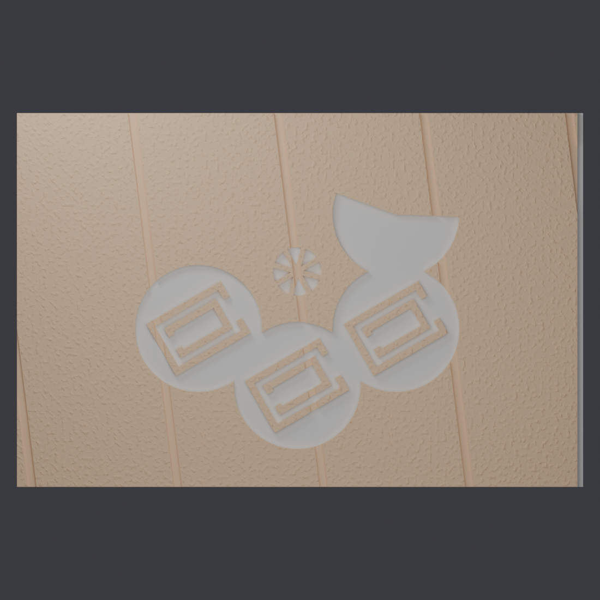

# Crop Circle Photo Floor

A 300 × 200 mm tiled floor for tabletop photography: a grassy field with a
half-formed crop circle pressed into it, as if whatever is hovering over it is
partway through making it. It was designed to sit under a 138 mm model flying
saucer, shot from directly overhead.

It comes as three 100 × 200 mm tiles that lap together, plus a small seam
gauge. A single filament change halfway up the tile turns the pressed-down
crop pale and leaves the standing crop golden, so the formation reads from
directly above, where the shallow recess alone would cast almost no shadow.



## Files

| file | what it is |
|---|---|
| `gw_seam_gauge.stl` | two short stubs of the tile joint. Print this first |
| `gw_floor_0.stl` | tile 0 |
| `gw_floor_1.stl` | tile 1 |
| `gw_floor_2.stl` | tile 2 |
| `infinity_wall.scad` | the OpenSCAD source |
| `grass.py` | the Blender script that adds the grass texture |

**The grass texture is already in the supplied tile STLs.** You only need
`grass.py` if you change the tiles and want to re-texture them (see
Remixing).

The source can also make a curved backdrop ("cove") row to stand behind the
floor for low-angle shots. Those tiles aren't included: from overhead they
never appear in frame, and they would take more filament than the whole floor.

## 1. Print the seam gauge first

The tiles join with a half lap along their long edges. Print
`gw_seam_gauge.stl`, snap the two stubs apart at the thin bridges, and check
that they slide together with no force and without rattling. It takes a few
minutes and tells you whether the tiles will fit before you commit hours to
them. If the fit is too tight or too loose, change `seam_clr` (default
0.35 mm) and export your own tiles.

## 2. Print the tiles: one filament change at Z 5.6 mm

Each tile is 8 mm thick, with the crop circle recessed 2.4 mm into the top.
The recess floor sits exactly at **Z 5.6 mm**, which is the top of **layer 28**
at 0.2 mm layers.

- **Layers 1 to 28** (up to Z 5.6): the pale colour, for the flattened crop.
  The original used white.
- **Layer 29 onwards** (from Z 5.8): the golden colour, for the standing crop.
  The original used `FFB673`.

In Bambu Studio or OrcaSlicer, slice the tile, drag the layer slider to
**5.80 mm (layer 29)**, right-click and add a filament change there. On a
printer with one extruder and no colour system, add a pause there instead
and swap the spool by hand.

The change only lines up with the recess if the layers do: use **0.2 mm
layers, including a 0.2 mm first layer**, and no adaptive layer height. The
tramlines are cut shallower on purpose, so they stay in the golden colour.

The tile number (0, 1 or 2) is recessed into each tile's underside.

## Print settings

- PLA, 0.4 mm nozzle, 0.2 mm layers as above, no supports.
- Print each tile flat, exactly as exported. A tile needs 200 × 103 mm of bed.
- **Brim 5 mm with a 0 mm brim-object gap.** The tiles are big flat parts, and
  a brim with a gap tends to peel off with the corner it should be holding
  down.

## Laying it out

Lay the tiles side by side in order **0, 1, 2**, matching the numbers on the
undersides. Each tile has a tongue along the bottom half of one long edge and
a matching rebate under the opposite edge, so each tile's tongue slides under
the next tile's rebate and the top faces sit flush. The joint only fits one
way round, but it doesn't stop you putting the tiles in the wrong order, and
then the formation won't join up.

## Remixing

Open `infinity_wall.scad` in [OpenSCAD](https://openscad.org/). The settings
are at the top: `formed` (how far round the rosette the crop circle has got),
`sweep` (how much of the circle in progress is done), circle sizes and
positions, `crop_depth`, `tram_depth`, `seam_clr` and the tile size.

Export a tile without grass:

```sh
openscad --render -D 'part="floor_tile"' -D tile=0 -o gw_floor_0.raw.stl infinity_wall.scad
```

and repeat for `tile=1` and `tile=2`. Use `part="seam_gauge"` for the gauge and
`part="cove_tile"` for the backdrop. If you change `crop_depth`, keep
8 − `crop_depth` a whole number of layers (OpenSCAD stops with an error if it
isn't) and move the filament change to match.

To add the grass, run `grass.py` in [Blender](https://www.blender.org/)
(tested with 5.2) on each smooth tile:

```sh
blender --background --python grass.py -- gw_floor_0.raw.stl gw_floor_0.stl 2.0 0.6
```

The last two numbers are the size of the grass bumps and their height, in mm
(the supplied tiles use 2.0 and 0.6). It textures only the standing crop and
leaves the recess smooth, so the filament change still lands on a flat floor.

## Licence

[CC BY-NC-SA 4.0](https://creativecommons.org/licenses/by-nc-sa/4.0/). See
`LICENSE`.
