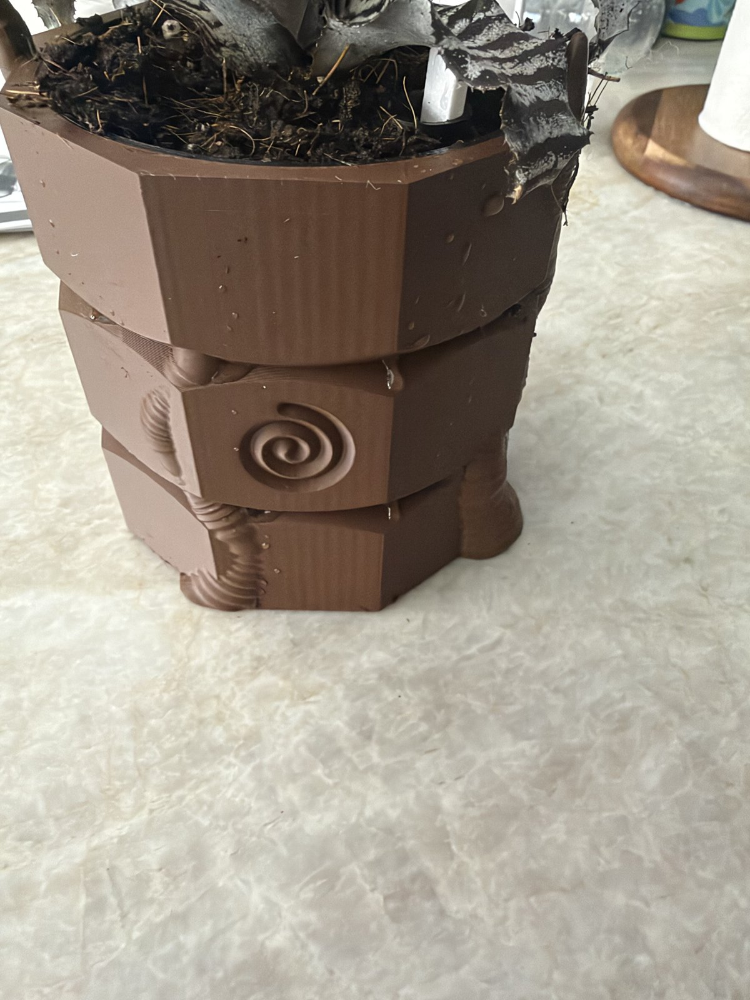

# Self-Watering Planter: R'lyeh Stone

**Also on MakerWorld:** [R'lyeh Stone Self-Watering Planter (Cthulhu)](https://makerworld.com/en/models/3510166-cthulhu-stone-self-watering-planter)

A self-watering planter for small indoor plants (about a 10 cm nursery pot).
The outside is a nine-sided block of sunken R'lyeh stone with carved spiral
glyphs and Cthulhu's tentacles climbing it. Two of them reach up over the rim.

It's two pieces and a dipstick, with no glue, screws or wick:

- **The shell** is the water reservoir, about 190 ml up to the full line.
- **The pot** holds the soil and sits inside the shell, hanging from its lip.
  Its floor is a steep cone that funnels down into a slotted **wicking
  well**. Soil packed into the well stands in the water and draws it up into
  the pot, so there's no cotton wick to rot or dry out.
- **The fill tube** at the pot's edge drops straight through to the
  reservoir. You water through it, and **the dipstick** stands in it and shows
  the level.
- **Air slots** in the pot's upper wall let the roots breathe. The gap behind
  them vents out through the fill tube and through notches hidden under the
  pot's lip.

`images/artwork.png` is a cutaway showing how the parts fit together.

The shell is about 124 × 117 mm and 116 mm to the rim (136 mm to the tentacle
tips). The pot's soil opening is 88 mm across.

## Files

| file | material / color | what it is |
|---|---|---|
| `planter_shell.stl` | PLA or PETG, stone color | the reservoir and the stone |
| `planter_pot.stl` | **PETG**, any color | the soil pot |
| `planter_dipstick.stl` | anything | the water-level dipstick |
| `planter_shell_mark_silver.stl` | silver PLA (optional) | the designer's mark under the shell: the B |
| `planter_shell_mark_red.stl` | red PLA (optional) | the mark's x |

## Printing

Three separate prints. **0.2 mm layers, no supports, no brim** for all of
them. Every overhang is designed to print at 0.2 mm (46° or less); taller
layers will start to droop under the tentacles.

### The shell

- Upright, open side up. That's how the STL is oriented.
- **Set wall loops to 5.** This is the one setting that matters. The walls
  are 2 mm, so 5 loops make them solid perimeter with no infill, and
  that's what keeps the water in. With the default 2 or 3 loops, sparse
  infill inside the wall can let water seep through.
- The floor is 8 layers, so the default 3 bottom and 5 top shells already
  make it solid.
- PLA is fine indoors and out of the sun. Use PETG anywhere warmer.
- **The mark is optional.** The shell has a shallow pocket under its base.
  To fill it, load the two mark STLs **as parts of the same object** as the
  shell (they're already positioned) and give them silver and red. They only
  fuse to a PLA shell. On PETG, or in one color, leave them out and the
  pocket prints as an engraved mark.
- Test it before you plant. Fill the shell with water and leave it on a
  paper towel for an hour.

### The pot

- **PETG**, because it's damp all the time.
- Upright, standing on its four fins. The fins widen its footprint, because
  the pot is tall and its well is small.
- Default walls are fine.

### The dipstick

Lies flat. Any material. The three notches mark full, half, and time to
refill.

## Using it

1. Drop the pot into the shell. Its lip settles on the shell's seat.
2. **Soil goes in the pot only.** Press soil firmly down into the well at the
   bottom first, since that's the wick, then fill and plant as usual. The shell
   holds only water.
3. Water the plant from the top once, to settle the soil and wet the wick.
4. From then on, water **down the fill tube.** Lift the dipstick out, pour,
   and dip it to check. The water is full when it reaches the top notch, the
   top of the well. Don't overfill. Above the full line the water reaches
   the bottom of the soil cone, and the soil stays soggy.
5. Refill when the water is down to the lowest notch. How fast that happens
   depends on the plant and the room, so check the dipstick every few days at
   first.

## Remixing

- **The planter** is `planter.scad`. Pot size, taper, cone angle, well,
  slots, fill tube and shell clearances are parameters at the top. The model
  asserts what it can't show: that the cone and lip stay inside the overhang
  limit, that the fill tube misses the well, that the dipstick fits the tube,
  and that the carving leaves enough wall to hold water.
- **The tentacles** are generated by `tentacles.py` (Python with numpy),
  which writes `tentacles.scad`. Each tentacle is a list of control points on
  the stone, with its thickness and how its end curls or rises. The script
  sinks each tentacle into the stone wherever its underside would overhang
  too far, and checks every point.
- **Your own shell:** keep `shell_cavity()` and the vents, and put any outside
  you like around them. The pot, the dipstick and the water line come from
  the same parameters, so they stay matched.

`./build.sh` regenerates everything. It needs Python 3 and OpenSCAD; the
first run makes a `.venv/` with numpy, manifold3d and shapely.
`clean_mesh.py` then collapses sliver edges along the tentacles. They're
harmless, but some mesh checkers flag them. The sources keep their folder
layout, because `planter.scad` finds the mark library at
`../Makers Mark/mark.scad`. Keep the two folders side by side.

**What's in the download:** the STLs and the OpenSCAD sources. The model sites
don't accept scripts, so the Python and shell tooling named above isn't
included. The `.scad` files, including the generated `tentacles.scad`, open
and render in OpenSCAD on their own.

## License

CC BY-NC-SA 4.0, see `LICENSE`. The BX mark under the shell is the designer's
signature and isn't covered by it. Remixes must not reuse it.

Cthulhu and R'lyeh come from H. P. Lovecraft's *The Call of Cthulhu* (1928),
which is in the public domain in the US. This is an original design, not
affiliated with or endorsed by any Lovecraft estate, publisher or game
licensee.
