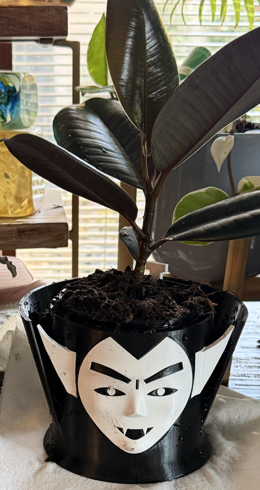

# Self-Watering Planter: Dracula

**Also on MakerWorld:** [Dracula Self-Watering Planter](https://makerworld.com/en/models/3519374-dracula-self-watering-planter)

A self-watering planter for small indoor plants (about a 10 cm nursery pot),
shaped as Dracula's head. He has a widow's peak, heavy brows, fangs,
swept-back pointed ears and a tall stand-up collar. The plant grows out of
the top of his head as his hair. It's printed in two colors, black and white,
as a single multi-color print.

It's two pieces and a dipstick, with no glue, screws or wick:

- **The head** is the water reservoir, about 190 ml up to the full line.
- **The pot** holds the soil and sits inside the head, hanging from its lip.
  Its floor is a steep cone that funnels down into a slotted **wicking
  well**. Soil packed into the well stands in the water and draws it up into
  the pot, so there's no cotton wick to rot or dry out.
- **The fill tube** at the pot's edge drops straight through to the
  reservoir. You water through it, and **the dipstick** stands in it and shows
  the level.
- **Air slots** in the pot's upper wall let the roots breathe. The gap behind
  them vents out through the fill tube and through notches hidden under the
  pot's lip.

The head is about 170 mm across the ears, 142 mm front to back and 116 mm to
the rim (134 mm to the top of the collar). The pot's soil opening is 88 mm
across.

The pot and dipstick are the same ones as in the R'lyeh Stone version of this
planter, so either shell takes either pot.

## Files

| file | material / color | what it is |
|---|---|---|
| `dracula_black.stl` | black PLA | the head, cape and collar |
| `dracula_white.stl` | white PLA | the face and ears, a part of the same object |
| `planter_pot.stl` | **PETG**, any color | the soil pot |
| `planter_dipstick.stl` | anything | the water-level dipstick |
| `dracula_mark_silver.stl` | silver PLA (optional) | the designer's mark under the head: the B |
| `dracula_mark_red.stl` | red PLA (optional) | the mark's x |

## Printing

Three separate prints. **0.2 mm layers, no supports, no brim** for all of
them. Every overhang is designed to print at 0.2 mm (46° or less): the nose,
chin and ears are sloped underneath, so nothing starts in mid-air. Taller
layers will start to droop.

### The head

- **Load the STLs together as one object.** Select `dracula_black.stl`,
  `dracula_white.stl` and, if you want the mark, the two mark STLs, and
  import them at once. When the slicer asks whether to load them as a single
  object with multiple parts, say **yes**. They're already positioned.
- Give the black part black, the white part white, and the mark parts silver
  and red.
- **Use PLA for every color.** The white is a 2 mm skin set into the black,
  and the colors only fuse if they're the same material.
- Upright, open side up. That's how the STLs are oriented.
- **Set wall loops to 5.** This is the setting that keeps the water in. The
  walls are 2 mm, so 5 loops make them solid perimeter with no infill. With
  the default 2 or 3 loops, sparse infill inside the wall can let water seep
  through.
- **It's a long print on a single-nozzle printer.** The face spans about 400
  layers with a color change on each, so with an AMS it takes about a day and
  wastes a fair amount of filament on purging. Turn on Bambu Studio's "Purge
  into objects' infill" to save some of it. Check that the prime tower sits
  fully on the plate, since the collar and ears make the head wide. On a
  two-nozzle printer it's far quicker.
- **The mark is optional.** Without the mark parts, the shallow pocket under
  the base prints as an engraved mark.
- Test it before you plant. Fill the head with water and leave it on a paper
  towel for an hour.

### The pot

- **PETG**, because it's damp all the time.
- Upright, standing on its four fins. The fins widen its footprint, because
  the pot is tall and its well is small.
- Default walls are fine.

### The dipstick

Lies flat. Any material. The three notches mark full, half, and time to
refill.

## Using it

1. Drop the pot into the head. Its lip settles on the head's seat.
2. **Soil goes in the pot only.** Press soil firmly down into the well at the
   bottom first, since that's the wick, then fill and plant as usual. The head
   holds only water.
3. Water the plant from the top once, to settle the soil and wet the wick.
4. From then on, water **down the fill tube.** Lift the dipstick out, pour,
   and dip it to check. The water is full when it reaches the top notch, the
   top of the well. Don't overfill. Above the full line the water reaches
   the bottom of the soil cone, and the soil stays soggy.
5. Refill when the water is down to the lowest notch. How fast that happens
   depends on the plant and the room, so check the dipstick every few days at
   first.

## Remixing

- **The planter** is `planter.scad`. Pot size, taper, cone angle, well,
  slots, fill tube and shell clearances are parameters at the top. The model
  asserts what it can't show: that the cone and lip stay inside the overhang
  limit, that the fill tube misses the well, that the dipstick fits the tube,
  and that the carving leaves enough wall to hold water.
- **The head** is generated by `dracula.py` (Python with numpy and shapely),
  which writes `dracula_shapes.scad`, and assembled in `dracula.scad`.
  - The head is a single surface: a radius at each angle and height, with
    the brow, nose, cheeks and chin added on the front. The script then
    limits how fast that radius may grow with height, so every bump is sloped
    underneath at 43° or less, and it checks every point.
  - The face is drawn flat, as seen from the front, and pushed straight back
    into a 2 mm white skin.
  - The ears are separate solid plates.
- **Your own shell:** keep `shell_cavity()` and the vents from `planter.scad`,
  and put any outside you like around them. The pot, the dipstick and the
  water line come from the same parameters, so they stay matched.

`./build.sh` regenerates everything. It needs Python 3 and OpenSCAD; the
first run makes a `.venv/` with numpy, manifold3d and shapely.
`clean_mesh.py` then collapses sliver edges left by the booleans. They're
harmless, but some mesh checkers flag them. The sources keep their folder
layout, because `planter.scad` finds the mark library at
`../Makers Mark/mark.scad`. Keep the two folders side by side.

**What's in the download:** the STLs and the OpenSCAD sources. The model sites
don't accept scripts, so the Python and shell tooling named above isn't
included. The `.scad` files, including the generated `dracula_shapes.scad`
and `tentacles.scad`, open and render in OpenSCAD on their own.

## License

CC BY-NC-SA 4.0, see `LICENSE`. The BX mark under the head is the designer's
signature and isn't covered by it. Remixes must not reuse it.

Dracula is the public-domain character from Bram Stoker's 1897 novel. This
is an original design, not affiliated with or endorsed by Universal Pictures
or any other studio.
