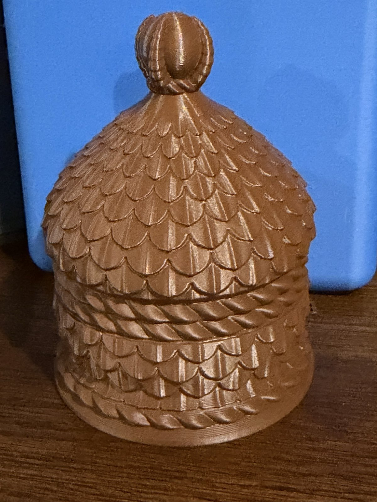

# Dragon Egg Gift Box



**Also on MakerWorld:** [Dragon Scale Gift Box for the Twisty Dragon Egg](https://makerworld.com/en/models/3564143-dragon-scale-gift-box-for-the-twisty-dragon-egg)

A dragon-scale presentation box for the **Textured Twisty Dragon Egg Fidget**
by NUKDDD ([MakerWorld model 2865269](https://makerworld.com/en/models/2865269-textured-twisty-dragon-egg-fidget)).
The egg stands upright in a cradle shaped to it. The lid lifts off and has a
claw gripping an orb on top.

Closed, it is 74mm across and 99mm tall. It prints as **two parts on one
plate, in one colour, with no supports and no brim**. The one in the photos is
brown PLA on a Bambu P1S, printed straight from these files (`images/`).

## You need the egg

This box is sized for one specific egg, and nothing here includes it:

**Textured Twisty Dragon Egg Fidget by NUKDDD:
<https://makerworld.com/en/models/2865269-textured-twisty-dragon-egg-fidget>**

Print it at 100% scale. The box was measured from that model's 3MF
(`twisty_textured_dragon_egg_fidget_16.3mf`) at 61.4mm tall and 52.0mm wide.
If you scaled your egg, or printed a different egg, see *Remixing*.

This box is a companion to NUKDDD's egg and is not affiliated with or endorsed
by them. The egg's model is theirs, and the box only uses its measured outline.

## Files

| file | what it is |
|---|---|
| `stl/box_base.stl` | the base: stands open side up; the BX mark is engraved underneath |
| `stl/box_lid.stl` | the lid: prints **rim down**, finial up, exactly as it sits in the file |
| `source/` | the OpenSCAD and Python sources, for remixing |

## Printing

**PLA, 0.2mm layers, no supports, no brim.** Any printer with a 75mm-square bed.

1. Load `stl/box_base.stl` and `stl/box_lid.stl` onto one plate, side by side, as two
   separate objects. Don't rotate either one.
2. Slice at **0.2mm**. Every overhang is held under 43 degrees for 0.2mm layers,
   so slicing at coarser layers can make the scale edges droop.
3. Both parts together take about 70g of filament and roughly 2.5 hours on a
   Bambu P1S.

Both files are centred on the origin, so a slicer may drop them on top of
each other: use its auto-arrange (A in Bambu Studio) to set them side by side.

Studio might colour some scale undersides red as overhangs. That's its
per-facet angle test. Each scale edge has a sloped underside, so none of them
needs support.

## Fit

- **Egg in the base:** 1.5mm clearance all round, and over the top of the egg.
  The egg drops in and lifts out by its top.
- **Lid on the base:** the lid slips over a 7mm collar with 0.22mm clearance and
  rests on the ledge below it, so the two rope bands meet at the seam.

## Remixing

The sources are in the zip, under `source/`. `box.py` builds the two shapes
(`box_base_shape.stl`, `box_lid_shape.stl`), and `dragon_egg_box.scad` imports
them and adds the mark, so run `box.py` before OpenSCAD. To fit
a different egg, replace `EGG_R` with the egg's largest radius in each 1mm
height band, and its height `EGG_H`. Every other size follows from those: the
cavity, the collar, the lid's height and the point inside the lid.

```sh
cd "source/Dragon Egg Box"
python box.py                                   # numpy + manifold3d
openscad --render -D 'part="base"' -o box_base.stl dragon_egg_box.scad
openscad --render -D 'part="lid"'  -o box_lid.stl  dragon_egg_box.scad
```

`box.py` stops with an error, giving a number, if the egg would touch the box,
the lid would clash or not seat, a wall would be thinner than 2.4mm, or any
surface would overhang past 43 degrees.

The BX mark is the designer's signature and is not covered by this licence.
Remixes must not reuse it.

## Licence

CC BY-NC-SA 4.0. See `LICENSE`.
