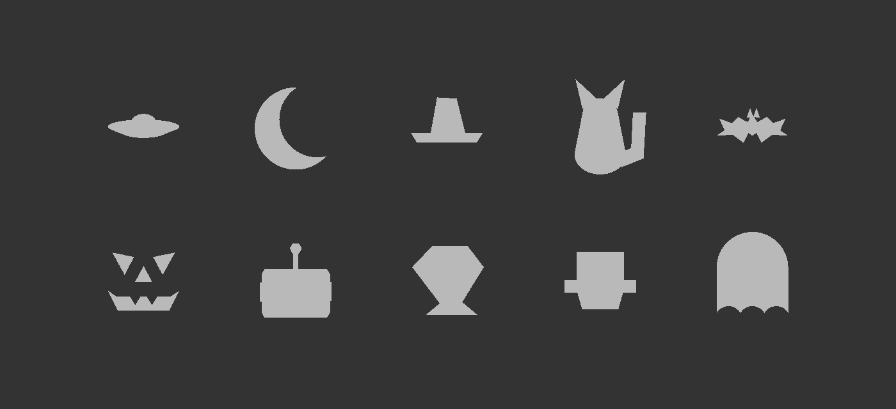
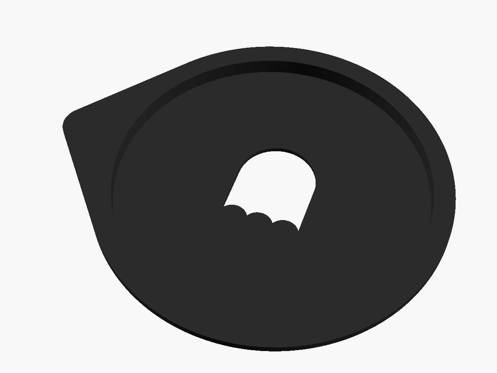
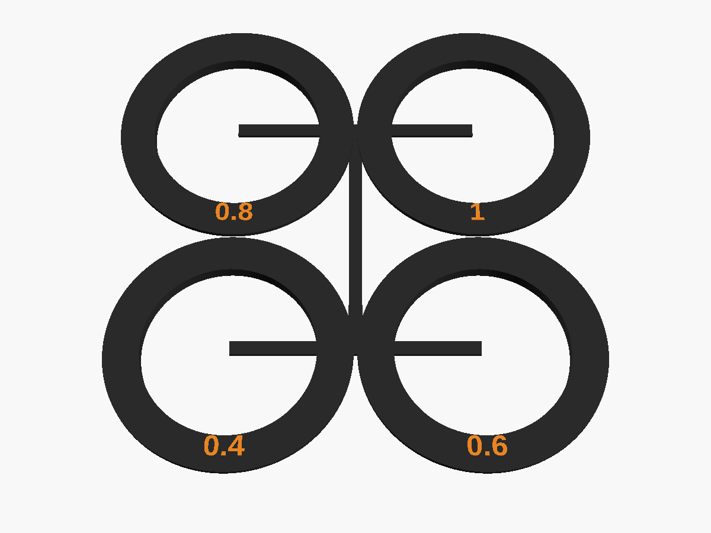

# Halloween Bokeh Masks

Printed masks that sit in your lens's filter thread and turn every
out-of-focus highlight into a Halloween shape: string lights behind your
subject become a background full of little ghosts, bats or jack-o'-lanterns.

There are ten shapes: **ghost, Frankenstein's monster, alien, robot,
jack-o'-lantern, bat, cat, witch's hat, moon and flying saucer**, each for
**62, 67, 77 and 82 mm** filter threads, plus a fit gauge for each thread.

## How it works

An out-of-focus point of light is a picture of the lens's aperture. Put a
shaped hole in front of the lens and the blur takes that shape. There is no
glass and no optics; the lens does all of it.

Two things follow from that:

- **The shape only appears if it is smaller than the lens's opening.** The
  opening (the entrance pupil) is the focal length divided by the f-number.
  The masks have a 16 mm cutout, so the lens needs more than 16 mm, for
  example an 85 mm at f/1.8 (47 mm), a 50 mm at f/1.8 (28 mm) or a 70-200 mm
  f/2.8 at 70 mm or longer. A wide-angle lens at f/4 does not have room, and
  you will just get round bokeh.
- **It costs light**, like stopping down. Expect to raise the ISO or slow the
  shutter.

The cutouts look upside down on the printed mask. That is on purpose:
highlights behind the subject render the aperture inverted, so the shape is
cut upside down to come out the right way up in the photo.

## 1. Print the gauge first

The mask is a smooth plug that pushes into the metal filter thread and is
held by friction, not screwed in. How snug that is depends on your printer
and filament, so print `bk_gauge_<thread>.stl` for your lens before any mask.
The filter thread size is printed on the front of the lens or on the lens cap
(the number after the ⌀ symbol, in mm).

The gauge is four test rings on one plate. Snap them apart. Each is marked
with how much smaller it is than the thread, in mm:

| ring | plug diameter |
|---|---|
| 0.4 | thread - 0.4 mm |
| 0.6 | thread - 0.6 mm |
| 0.8 | thread - 0.8 mm |
| 1 | thread - 1.0 mm |

Keep the one that pushes in snugly, stays put when you tilt the lens, and
pulls out again easily. The supplied masks use **0.4**. If a different ring
fits you better, make your own masks with that number (see Remixing).

## 2. Pick your files

Everything is under `stl/<thread>mm/`:

| file | what it is |
|---|---|
| `bk_gauge_<thread>.stl` | the fit gauge, print this first |
| `bk_<shape>_<thread>.stl` | one mask, e.g. `bk_ghost_67.stl` |

Shapes: `ghost`, `frank` (Frankenstein's monster), `alien`, `robot`,
`pumpkin`, `bat`, `cat`, `hat`, `moon`, `saucer`.

## 3. Print settings

- **Matte black** filament, PLA or PETG. The mask must be opaque and should
  not reflect light back into the lens.
- 0.2 mm layers, 0.4 mm nozzle.
- **No supports.** Print each mask exactly as exported, flat plate on the bed.
- One mask per print. They are small and quick.

## 4. Using it

1. Take off any filter and the lens cap. Take off the lens hood too if the
   mask's pull tab catches on it.
2. Push the mask straight into the filter thread, plate first, until the
   flange sits against the front of the lens. Do not twist it in.
3. Shoot with the lens wide open, or close to it (f/1.4 to f/2.8 works best).
4. Focus on something close, with small bright lights well behind it: fairy
   lights, candles, street lights, sun through leaves. The further the lights
   are out of focus, the bigger and clearer the shapes.
5. Pull it out by the tab.

## Remixing

`source/bokeh.scad` makes every file here. Open it in
[OpenSCAD](https://openscad.org/) and use the Customizer:

| setting | default | what it does |
|---|---|---|
| `part` | `gauge` | `gauge` or `mask` |
| `who` | `ghost` | the shape (see the list above) |
| `thread` | 67 | filter thread diameter, mm. Any size works, not only the four supplied |
| `plug_clear` | 0.4 | the gauge ring that fitted you |
| `cut_size` | 16 | cutout size, mm. Bigger is brighter and bolder, if your lens has room |
| `lens_fl`, `lens_fn` | 85, 1.8 | the lens you will use. Used only to check `cut_size`: the file refuses to render a cutout too big for that lens |
| `invert` | true | cut upside down for background bokeh. Set false for highlights in front of the subject |

Press F6 to render, then File > Export > Export as STL.

## Licence

[CC BY-NC-SA 4.0](https://creativecommons.org/licenses/by-nc-sa/4.0/). See
`LICENSE`.

Frankenstein's monster here is the public-domain character from Mary
Shelley's 1818 novel. This project is not affiliated with or endorsed by
Universal Pictures.
