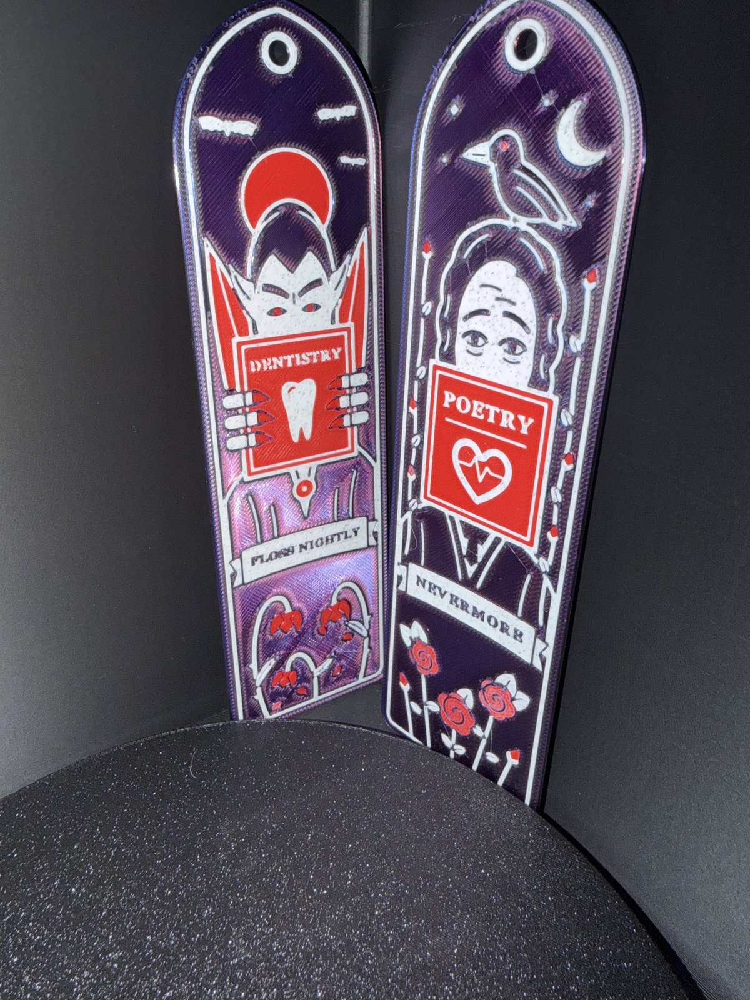

# Halloween Bookmarks



**Also on MakerWorld:** [Halloween Bookmarks](https://makerworld.com/en/models/3403477-halloween-bookmarks-dracula-and-poe)

Two flat, three-colour bookmarks with a gothic-arch top and a tassel hole:

- **Dracula** glares over a book called *DENTISTRY*, gripping it with clawed
  fingers. A blood moon and bats sit behind him, wilted roses below, and a
  banner reads *FLOSS NIGHTLY*.
- **Edgar Allan Poe** peers over a book called *POETRY* with a tell-tale heart
  on the cover. A raven perches on his head, rose vines climb the sides, and a
  banner reads *NEVERMORE*.

On MakerWorld, with a ready-to-print H2D profile: https://makerworld.com/en/models/3403477-halloween-bookmarks-dracula-and-poe

Each is 48 × 175 × 1.8 mm and uses about 18 g of filament. The artwork is a
flush inlay, so the surface is flat and won't snag pages.

## Files

Each bookmark is three STLs, one per colour:

| file | what it is | colour on the original |
|---|---|---|
| `<name>_purple.stl` | the plate | blue/red dual-colour silk, which reads as purple |
| `<name>_bone.stl` | line art, faces, text, banner | bone / off-white |
| `<name>_red.stl` | moon, book cover, roses, eyes | red |

The file names are only the colours of the original print. Use any three
colours that contrast. Black, white and red work too.

## Printing

**You need a multi-colour printer:** an AMS, MMU, tool changer or similar. The
light and accent colours share the same top layers, so a manual filament swap
at a layer height cannot print them.

1. Import all three STLs for one bookmark **at the same time**. In Bambu Studio
   or OrcaSlicer, answer **Yes** when asked whether to load them as a single
   object with multiple parts. They are already positioned relative to each
   other, so don't move them.
2. Give each part its own filament.
3. Settings:
   - PLA, 0.4 mm nozzle, 0.2 mm layers or finer. The original was printed at
     0.16 mm.
   - No supports.
   - If the corners lift on your printer, add a 5 mm brim with a 0 mm
     brim-object gap.

The colour changes all happen in the top 0.6 mm, so purge waste is small.

**Optional, face-down:** flip the object so the artwork sits on the build
plate. You get the plate's texture or gloss on the artwork. The light colour is
then only 0.6 mm thick over the plate colour, so a white can look slightly
tinted. Rebuild with a deeper inlay (see Remixing) if that bothers you.

Thread a tassel or ribbon through the 5.2 mm hole.

### How fine is the detail?

The finest lines are 0.55 mm and the narrowest gaps between same-coloured
parts are 0.35 mm. They printed cleanly with a standard 0.4 mm nozzle on a
Bambu Lab H2D. The roughest part was the plate-coloured *FLOSS NIGHTLY* lettering cut
into the white banner. It is still legible, but if your printer struggles,
that is where it will show first.

## Remixing

The artwork is drawn in Python, not in a CAD program. The sources are in
`source/`:

| file | what it does |
|---|---|
| `lib.py` | a small 2D drawing kit: paths, strokes, text, and a painter that keeps the colours from overlapping |
| `dracula.py`, `poe.py` | the two designs, as coordinates in mm |
| `build.sh` | rebuilds the previews, the `.scad` files and all six STLs |

You need Python 3 and [OpenSCAD](https://openscad.org/). Then run:

```sh
cd source
./build.sh
```

The first run creates a `.venv/` with shapely and matplotlib. Outputs land in
`out/`: a preview PNG of each design, the generated `.scad` file and the STLs.

- **Thickness:** `total` (1.8 mm) and `inlay` (0.6 mm) are arguments to
  `write_scad()` in `lib.py`. You can also change them at the top of the
  generated `.scad` file.
- **Text:** the lettering uses **Georgia Bold**. If Georgia isn't installed,
  the build falls back to DejaVu Serif Bold, which comes with matplotlib. The
  text will then look slightly different from the published STLs.
- **Colours:** `PALETTE` in `lib.py` only affects the previews. The printed
  colours are whatever you load.

## Licence

[CC BY-NC-SA 4.0](https://creativecommons.org/licenses/by-nc-sa/4.0/). See
`LICENSE`.

Dracula is the public-domain character from Bram Stoker's 1897 novel. This
project is not affiliated with or endorsed by Universal Pictures.
