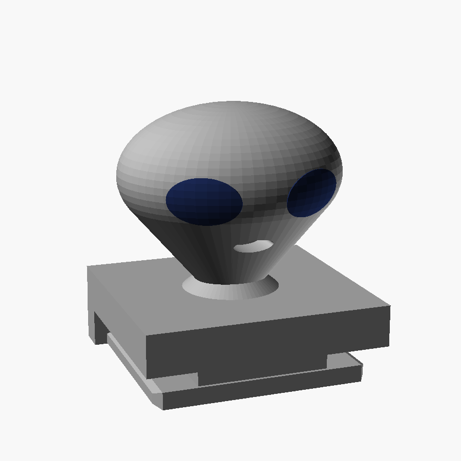

# Halloween Hot Shoe Covers

Two characters that slide into your camera's hot shoe: an **alien** and a
**robot**. Each comes in one colour or two. There are also display busts at 4.6x scale, for photographing
next to the real thing.

On MakerWorld:
- Alien: https://makerworld.com/en/models/3403737-alien-hot-shoe-cover
- Robot: https://makerworld.com/en/models/3403886-robot-hot-shoe-cover

Designed for and fitted on a Nikon Z5II / Z6III. They use the standard
ISO 518 shoe, so any camera with a standard hot shoe should take them.

## 1. Print the gauge first

The foot is a friction fit into a metal channel. Published shoe dimensions
disagree, and every printer and filament comes out slightly different. So
before printing a cover, print `gauge.stl`: four test feet on one plate,
marked with 1-4 bars.

| bars | foot width |
|---|---|
| 1 | 18.50 mm |
| 2 | 18.75 mm |
| 3 | 19.00 mm |
| 4 | 19.25 mm |

Keep the one that slides in with light thumb pressure and doesn't rattle. The
supplied STLs use **18.75 mm**, which fit a Nikon Z shoe in PETG on a
Bambu Lab P1S. If a different gauge foot fits you, open `hotshoe.scad` in
OpenSCAD, set `foot_w` in the Customizer, and export your own.

## 2. Pick your files

Every character comes in these versions:

| file | what it is |
|---|---|
| `<name>_single.stl` | one filament; the face is cut in, so it reads as shadow |
| `<name>_body.stl` + `<name>_accent.stl` | two filaments |
| `<name>_display*.stl` | the same set, as a display bust on a plinth (the alien bust is two-colour only) |

**Multi-colour:** import the body and accent **together, as one
object with several parts**. In Bambu Studio / OrcaSlicer, answer "Yes" when
asked whether to load them as a single object with multiple parts. They are
already in the right place relative to each other, so don't move them. Then
give each part its own filament.

**Suggested colours for the alien:** a grey head with dark blue or black eyes.

For the alien, `_single` and `_body` are the same shape: its eyes are a
recess either way.

## 3. Print settings

- **PETG** is recommended. The cover lives on a camera that sits in hot bags and
  hot cars, and PLA softens at around 60 °C.
- 0.2 mm layers, 0.4 mm nozzle.
- **No supports.** Print the covers standing on their foot, exactly as exported.
- 5 mm brim with **0 brim-object gap**. The footprint is small, and a brim with
  a gap tends to peel away with the corner it's meant to hold.
- The display busts also need no supports.

## Remixing

`hotshoe.scad` holds everything, with Customizer controls for character,
part and foot width. Every design decision in it is commented with the reason,
including the ones that failed.

## Licence

[CC BY-NC-SA 4.0](https://creativecommons.org/licenses/by-nc-sa/4.0/) - see
`LICENSE`. Nikon is a trademark of Nikon Corporation; this project is not
affiliated with or endorsed by Nikon.
