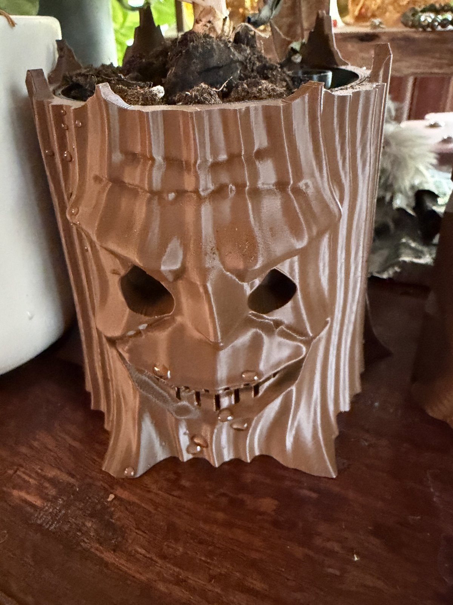

# Self-Watering Planter: Haunted Tree

**Also on MakerWorld:** [Haunted Tree Self-Watering Planter](https://makerworld.com/en/models/3525274-haunted-tree-self-watering-planter)

A self-watering planter for small indoor plants (about a 10 cm nursery pot),
shaped as the trunk of a dead tree with a face in its bark. It has hollow
knot-hole eyes under a heavy brow, a long gnarled nose and a crooked-toothed
grin. The trunk is broken off at the top in jagged splinters, and the plant
grows out of the break as the tree's crown. Roots flare out over the ground at
its foot. It prints in one color: the face is all carving and shadow.

It's two pieces and a dipstick, with no glue, screws or wick:

- **The trunk** is the water reservoir, about 190 ml up to the full line.
- **The pot** holds the soil and sits inside the trunk, hanging from its lip.
  Its floor is a steep cone that funnels down into a slotted **wicking
  well**. Soil packed into the well stands in the water and draws it up into
  the pot, so there's no cotton wick to rot or dry out.
- **The fill tube** at the pot's edge drops straight through to the
  reservoir. You water through it, and **the dipstick** stands in it and shows
  the level.
- **Air slots** in the pot's upper wall let the roots breathe. The gap behind
  them vents out through the fill tube and through notches hidden under the
  pot's lip.

The eyes and the gaps between the teeth are cut deep into the bark, but they
stop short of the reservoir, so they never leak.

The trunk is about 155 × 146 mm across the roots and 116 mm to the rim
(139 mm to the tallest splinter). The pot's soil opening is 88 mm across.

The pot and dipstick are the same ones as in the R'lyeh Stone and Dracula
versions of this planter, so any shell takes any pot.

## Files

| file | material / color | what it is |
|---|---|---|
| `tree.stl` | PLA or PETG, a bark color | the trunk and reservoir |
| `planter_pot.stl` | **PETG**, any color | the soil pot |
| `planter_dipstick.stl` | anything | the water-level dipstick |
| `tree_mark_silver.stl` | silver PLA (optional) | the designer's mark under the trunk: the B |
| `tree_mark_red.stl` | red PLA (optional) | the mark's x |

## Printing

Three separate prints. **0.2 mm layers, no supports, no brim** for all of
them. Every overhang is designed to print at 0.2 mm (46° or less): the brow,
nose and roots are sloped underneath, and the eyes are teardrops with pointed
tops, so nothing starts in mid-air. Taller layers will start to droop.

### The trunk

- Upright, open side up. That's how the STL is oriented.
- **Set wall loops to 5.** This is the one setting that matters. The walls
  are 2 mm, so 5 loops make them solid perimeter with no infill, and
  that's what keeps the water in. With the default 2 or 3 loops, sparse
  infill inside the wall can let water seep through.
- PLA is fine indoors and out of the sun. Use PETG anywhere warmer. A silk
  or shiny brown shows the bark grain best; the one in the photos is a
  brown PLA.
- **The mark is optional.** The trunk has a shallow pocket under its base.
  To fill it, load the two mark STLs **as parts of the same object** as the
  trunk (they're already positioned) and give them silver and red. They only
  fuse to a PLA trunk. On PETG, or in one color, leave them out and the
  pocket prints as an engraved mark.
- Test it before you plant. Fill the trunk with water and leave it on a
  paper towel for an hour.

### The pot

- **PETG**, because it's damp all the time.
- Upright, standing on its four fins. The fins widen its footprint, because
  the pot is tall and its well is small.
- Default walls are fine.

### The dipstick

Lies flat. Any material. The three notches mark full, half, and time to
refill.

## Using it

1. Drop the pot into the trunk. Its lip settles on the seat inside the
   splinters.
2. **Soil goes in the pot only.** Press soil firmly down into the well at the
   bottom first, since that's the wick, then fill and plant as usual. The
   trunk holds only water.
3. Water the plant from the top once, to settle the soil and wet the wick.
4. From then on, water **down the fill tube.** Lift the dipstick out, pour,
   and dip it to check. The water is full when it reaches the top notch, the
   top of the well. Don't overfill. Above the full line the water reaches
   the bottom of the soil cone, and the soil stays soggy.
5. Refill when the water is down to the lowest notch. How fast that happens
   depends on the plant and the room, so check the dipstick every few days at
   first.

## Remixing

- **The planter** is `planter.scad`. Pot size, taper, cone angle, well,
  slots, fill tube and shell clearances are parameters at the top. The model
  asserts what it can't show: that the cone and lip stay inside the overhang
  limit, that the fill tube misses the well, that the dipstick fits the tube,
  and that the carving leaves enough wall to hold water.
- **The trunk** is generated by `tree.py` (Python with numpy and shapely),
  which writes `tree_shapes.scad`, and assembled in `tree.scad`.
  - The trunk is a single surface: a radius at each angle and height, with
    the roots, bark furrows and the face's relief added on. The script then
    limits how fast that radius may grow with height, so every bump is sloped
    underneath at 43° or less, and it checks every point.
  - The face swells out of the trunk, which buys depth for the eyes and the
    grin without thinning the reservoir wall. Every point keeps 2 mm of solid
    between it and the water.
  - The eye holes and the gaps between the teeth are cut in `tree.scad`, back
    to a plane 2 mm outside the reservoir.
  - The splinters, the face and the grin are lists of numbers near the top of
    `tree.py`.
- **Your own shell:** keep `shell_cavity()` and the vents from `planter.scad`,
  and put any outside you like around them. The pot, the dipstick and the
  water line come from the same parameters, so they stay matched.

`./build.sh` regenerates everything. It needs Python 3 and OpenSCAD; the
first run makes a `.venv/` with numpy, manifold3d and shapely.
`clean_mesh.py` then collapses sliver edges left by the booleans. They're
harmless, but some mesh checkers flag them. The sources keep their folder
layout, because `planter.scad` finds the mark library at
`../Makers Mark/mark.scad`. Keep the two folders side by side.

**What's in the download:** the STLs and the OpenSCAD sources. The model sites
don't accept scripts, so the Python and shell tooling named above isn't
included. The `.scad` files, including the generated `tree_shapes.scad` and
`tentacles.scad`, open and render in OpenSCAD on their own.

## License

CC BY-NC-SA 4.0, see `LICENSE`. The BX mark under the trunk is the designer's
signature and isn't covered by it. Remixes must not reuse it.
