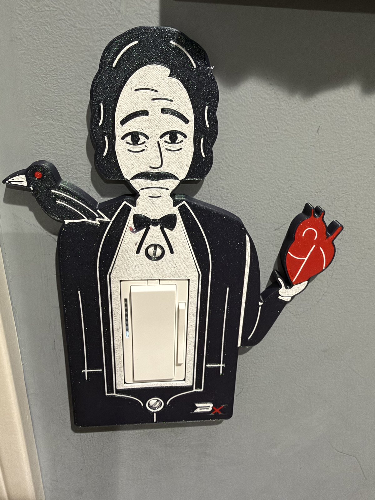

# Poe Switch Plate

**Also on MakerWorld:** [Edgar Allan Poe Light Switch Plate (Decora Rocker)](https://makerworld.com/en/models/3453566-poe-switch-plate-cover)

Edgar Allan Poe as a cover for a US rocker light switch. His coat is the
plate, and the rocker comes through his white shirt front. He holds out a
human heart (*The Tell-Tale Heart*), and a raven sits on his shoulder. The top
screw is his shirt stud and the bottom one is a coat button.

The face, hair and raven are the Poe from the designer's Halloween
Bookmarks, scaled up, so the two match.

About 152 × 206 mm and 6 mm deep. It fits one **Decora (rocker) switch** and
covers everything a standard 2.75" × 4.5" plate does, with at least 3 mm to spare.

It sticks out well past a normal plate, and not evenly. **The heart reaches
89 mm to the right of the switch's centre** and the raven 63 mm to the left.
The switch needs clear, flat wall on the heart side. A door casing, a second
switch or a corner within 89 mm will hold the plate off the wall.

## Files

| file | colour | what it is |
|---|---|---|
| `poe_coat.stl` | black (any dark colour) | the figure |
| `poe_bone.stl` | bone / white | face, hands, shirt, line work |
| `poe_red.stl` | red | the heart, the raven's eye, the mark's x |
| `poe_mark_silver.stl` | silver (or the bone filament) | the mark's B |
| `poe_gauge.stl` | anything | a quick one-colour fit test, printed on its own |

## Print the gauge first

`poe_gauge.stl` is just the plate around the switch: the opening, both screw
holes and the hollow back, with no figure. It is a short print in one
colour. Screw it on and check:

- the rocker sits in the opening without rubbing, and rocks freely
- BOTH screws go in and tighten (one screw alone will hold it, and hide a
  wrong spacing), and their heads sit flush in the countersinks
- the plate's face is level with the rocker's frame, and its edge sits
  on the wall all round

If any of these is off, change the matching number at the top of
`switchplate.scad` (`open_w`/`open_h`/`open_fit`, `screw_c`, `depth`) and
rebuild. Nothing else depends on them.

## Printing

**H2D (or any multi-colour printer), PLA, 0.2 mm layers, no supports, no brim.**

1. Import the four colour STLs together and load them as **one object with
   several parts**. They're already positioned.
2. Give each part its filament from the table.
3. It prints **face down**: the artwork is on the bed, so it comes out smooth,
   and every colour change happens in the first 0.8 mm. The back, with the
   hollow for the switch, faces up.

Studio will warn about separate bodies in the inlay parts: each one holds
many separate pieces of artwork. That's expected.

## Mounting

Two #6-32 oval-head screws, the same ones the old plate used. The plate
screws go into the switch's mounting strap, 3-13/16" (96.8 mm) apart, the
standard Decora plate spacing.

## Remixing

- **The artwork** is drawn in `art.py` (Python, with shapely), using the
  bookmarks' drawing kit. It writes `art.scad`.
- **The 3D plate** is `switchplate.scad`: depth, opening, screws, hollow and
  inlay depth are parameters at the top. The model asserts what it can't show:
  that the countersink stays inside the overhang limit, that the screw bosses
  clear the opening, and that the inlay is a whole number of layers.

`./build.sh` regenerates everything. It needs Python 3 and OpenSCAD, and the
first run makes a `.venv/` with shapely and matplotlib. The sources keep their
folder layout, because they find each other by relative path:
`Poe Switch Plate/` holds the plate, `Halloween Bookmarks/lib.py` is the
drawing kit, and `Makers Mark/` is the mark library. Keep the three folders
side by side.

**What's in the download:** the STLs and the OpenSCAD sources. The model sites
don't accept scripts, so the Python and shell tooling named above isn't included;
the `.scad` files, including the generated ones, open and render in OpenSCAD on
their own.

## Licence

CC BY-NC-SA 4.0, see `LICENSE`. The BX mark on the coat is the designer's
signature and isn't covered by it. Remixes must not reuse it.

Edgar Allan Poe (1809–1849) is a historical figure. This is an original
drawing, not based on any one portrait.
