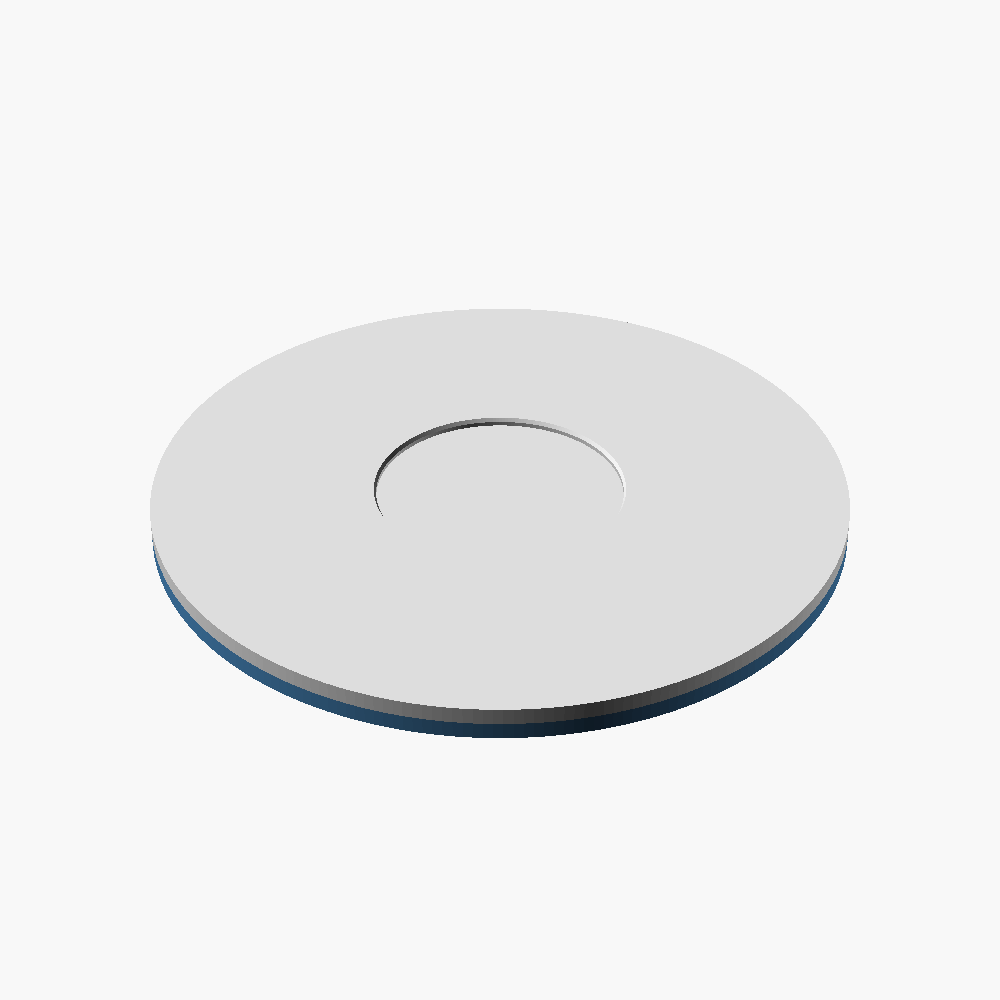

# Saucer Turntable Topper



A printed platter that drops onto a store-bought **200 mm ComXim motorised
turntable** and holds the **UFO lens saucer** (published separately) dead
centre while it spins, for product-style photos and video.

The turntable does the motor part. The print adds what a bought turntable
can't: a shallow seat shaped for the saucer, and a locator ring so the platter
finds its own centre on the turntable.

It was designed for unsteady hands. Everything **drops on** and centres
itself: the ring funnels onto the turntable, the saucer drops into its seat,
and nothing needs aiming or holding while something else is tightened. The
platter overhangs the turntable by 6 mm all the way round, so you can lift it
off with your fingers anywhere. No fasteners.

## Files

| file | what it is |
|---|---|
| `stl/tt_gauge.stl` | a 60-degree test arc of the ring, about 10 minutes to print. **Print this first** |
| `stl/tt_ring.stl` | the locator ring, 212 mm across, 5 mm tall |
| `stl/tt_platter.stl` | the platter, 212 mm across, 5 mm thick, with the saucer seat on top. About 3 hours |
| `source/topper.scad` | the OpenSCAD source |

**You need a bed at least 215 × 215 mm** for the ring and platter.

## 1. Print the gauge first

The "20 cm" on the box is a round number. The ring has to fit the real disc,
so print `tt_gauge.stl` (one colour, flat, no supports) and try it on the edge
of your turntable's spinning disc:

- It should drop over the edge with a little play, about 0.8 mm. That is loose
  on purpose, so it never needs aiming.
- Its 5 mm height must be **less** than how far the disc's edge stands proud of
  the turntable's body. Otherwise the ring sits on the housing and the topper
  rocks.

If it doesn't fit, measure your disc with calipers and change `comxim_d` and
`comxim_lip` (see Remixing), then export the ring and platter yourself.

## 2. Print the ring and platter

Any PLA, 0.4 mm nozzle, 0.2 mm layers, no supports. Both are big flat parts:

- **Brim: 5 mm, 0 mm brim-object gap**, so the edges don't lift.
- **Platter:** right way up, as loaded. The saucer seat is a shallow recess in
  the top face, and the whole bottom is the first layer.
- **Ring:** flat, as loaded. The chamfer on its inner bottom edge is the
  lead-in that funnels it onto the turntable, so keep that side down.

A neutral grey or white platter keeps colour casts off the saucer in photos.

Developed on a Bambu Lab P1S.

## 3. Assemble

1. Put the platter **upside down** on a flat bench.
2. Spread glue on the ring's **top** face (the side without the chamfer). CA,
   plastic cement or a thin bead of epoxy all work. It is a wide flat
   ring, so it bonds well.
3. Lay the ring on the platter with the outer edges flush all the way round.
   They are the same diameter, so run a finger round the edge to line them up.
   Weigh it down until the glue sets.
4. Turn it over and drop it onto the turntable.
5. Drop the lens saucer into the seat. It rests on the bottom of its bell, not
   on its rim, so the seat is sized to that 74 mm footprint.

## Remixing

Open `topper.scad` in [OpenSCAD](https://openscad.org/), set `part` to
`gauge`, `ring` or `platter`, press F6, then File > Export > Export as STL.
`view_assembly` is a picture of the two parts together, not a print. From the
command line:

```sh
openscad --render -D 'part="ring"' -o tt_ring.stl topper.scad
```

| setting | default | what it does |
|---|---|---|
| `comxim_d` | 200 | **measured** diameter of your turntable's spinning disc |
| `comxim_lip` | 8 | how far that disc's edge stands proud of the body below it |
| `ring_clear` | 0.8 | clearance between ring and disc. Loose on purpose |
| `overhang` | 6 | how far the platter sticks out past the turntable, for your fingers |
| `plate_t` | 5 | platter thickness. 4 mm flexed visibly at this size |
| `ring_h` | 5 | ring height. Must stay under `comxim_lip` |
| `saucer_foot_d` | 73.8 | diameter of whatever sits in the seat |
| `saucer_fit` | 1.7 | clearance around it |
| `recess_h` | 2.5 | seat depth |

The file checks itself and stops with an error if the ring would bottom out
on the turntable, its wall would be too thin, or the topper would grow past
230 mm across. To hold something other than the saucer, change
`saucer_foot_d` to its footprint.

## Not affiliated

ComXim is a trademark of its owner. This project is not affiliated with or
endorsed by ComXim; the name is used only to describe which turntable it fits.

## Licence

[CC BY-NC-SA 4.0](https://creativecommons.org/licenses/by-nc-sa/4.0/). See
`LICENSE`.
