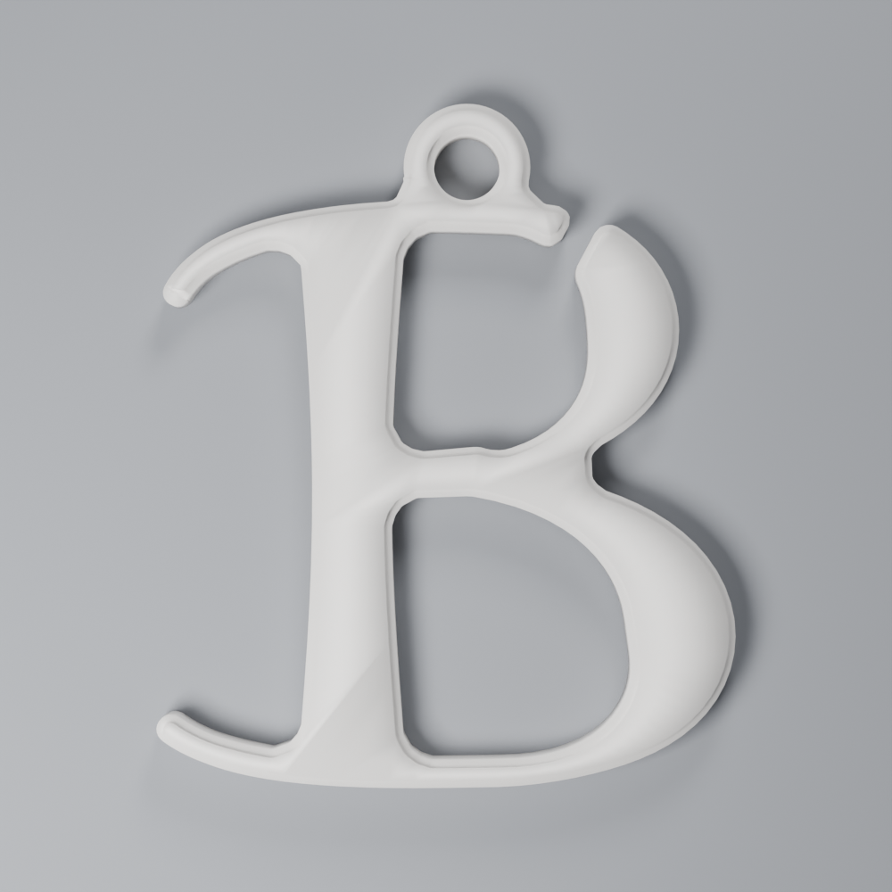

# Scarlet B Pendant

A letter B pendant, drawn in the manner of the cut-out A on covers of
*The Scarlet Letter*: a heavy stem, hairline curves, cupped sweeping serifs,
and a slanted break through the thin stroke at the top of the bowl.



It is 31 × 36 × 2.4 mm including the loop, and weighs about 1 g. The loop
sits over the letter's balance point, so it hangs level, and its 3.5 mm hole
takes a fine chain's end ring or a cord up to about 2 mm.

## Files

| file | what it is |
|---|---|
| `scarlet_b.stl` | the pendant: one part, one colour |

## Printing

- Scarlet red PLA, 0.4 mm nozzle, 0.2 mm layers.
- Flat on the bed, as the STL comes. The bevelled face goes up: it is the
  front, and the bed side is the smooth back.
- No supports, no brim.

Every stroke, tip and gap is at least 1.2 mm, about three nozzle widths, so
it prints as drawn on a standard 0.4 mm nozzle.

## Remixing

You need [OpenSCAD](https://openscad.org/) and Python 3.

| file | what it does |
|---|---|
| `scarlet_b.scad` | the letter, drawn as broad-nib pen strokes along Bezier curves, plus the loop and bevel |
| `shape.py` | turns the drawn outline into `pendant_shape.scad`, and checks the balance |
| `pendant_shape.scad` | the cleaned outline the pendant is extruded from (generated) |

Change the size with `letter_h`, the contrast with `nib_a` (the pen angle),
or the strokes themselves in `b_2d()`. Then run:

```sh
python3 shape.py               # OPENSCAD=/path/to/openscad if it is not on PATH
openscad -o scarlet_b.stl scarlet_b.scad
```

`shape.py` exists because the pen's rounded offsets leave vertices a few
thousandths of a millimetre apart, which slicers merge into non-manifold
edges. It simplifies the outline to 0.005 mm. It also stops if the loop no
longer sits over the letter's centroid and tells you the new `hang_x`.

## Licence

CC BY-NC-SA 4.0. See `LICENSE`.

*The Scarlet Letter* (Nathaniel Hawthorne, 1850) is in the public domain.
This letterform is an original drawing in the spirit of that cover design,
and is not affiliated with or endorsed by any publisher or cover designer.
