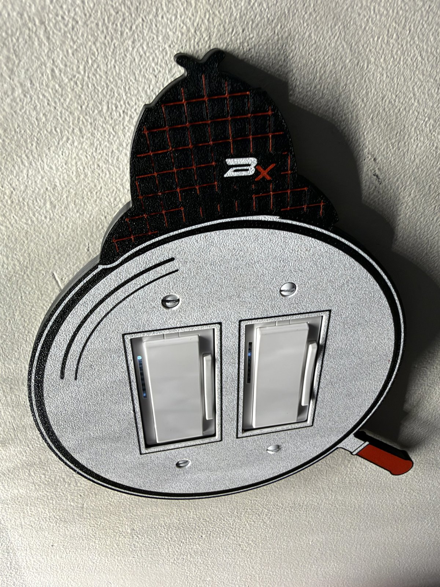

# Sherlock Double Switch Plate

**Also on MakerWorld:** [Sherlock Holmes 2-Gang Light Switch Plate (Decora)](https://makerworld.com/en/models/3566148-sherlock-holmes-2-gang-light-switch-plate-decora)

Sherlock Holmes's magnifying glass as a cover for two US rocker light
switches side by side. Both rockers sit inside the big round lens, the
deerstalker rests on top of the rim, tipped, and the glass's red handle runs
off to the lower right.

About 192 × 227 mm and 6 mm deep. It fits a **two-gang box with two Decora
(rocker) switches** at the standard 1.812" (46 mm) spacing, and covers
everything a standard 2-gang plate does.

It is much bigger than a normal plate, and not evenly. Measured from the
middle between the two switches, it reaches **83 mm to the left, 109 mm to
the right (the handle), 134 mm up (the hat) and 93 mm down**. The switches
need clear, flat wall that far on each side. A door casing, another switch or
a corner any closer will hold the plate off the wall.

It's the two-gang companion to the one-gang
[Sherlock Holmes Light Switch Plate](https://makerworld.com/en/models/3459979-sherlock-holmes-light-switch-plate-decora-rocker),
and uses the same deerstalker and the same fitted switch openings.

## Files

| file | colour | what it is |
|---|---|---|
| `sherlock_double_body.stl` | any dark colour (black shown) | the rim, the hat and the back |
| `sherlock_double_bone.stl` | bone / white | the glass, the rim's line, the handle's ferrule |
| `sherlock_double_red.stl` | red | the hat's check, the handle, the mark's x |
| `sherlock_double_mark_silver.stl` | silver (or the bone filament) | the mark's B |
| `sherlock_double_gauge.stl` | anything | a quick one-colour fit test, printed on its own |

## Print the gauge first

`sherlock_double_gauge.stl` is just the plate around the two switches: both
openings, all four screw holes and the hollow back, with no artwork. It is a
short print in one colour. Screw it on and check:

- each rocker sits in its opening without rubbing, and rocks freely
- ALL FOUR screws go in and tighten, and their heads sit in the countersinks
- the plate's face is level with the rockers' frames, and its edge sits on
  the wall all round

If any of these is off, change the matching number at the top of
`switchplate.scad` (`gang`, `open_w`/`open_h`/`open_fit`, `screw_c`, `depth`)
and rebuild. Nothing else depends on them.

## Printing

**A multi-colour printer (H2D, or a P1S/X1 with an AMS), PLA, 0.2 mm layers,
no supports, no brim.** The photographed plate was printed on an H2D at
0.16 mm, and that works too. About 3.5 to 4 hours.

1. Import the four colour STLs together and load them as **one object with
   several parts**. They're already positioned.
2. Give each part its filament from the table.
3. It prints **face down**: the artwork is on the bed, so it comes out
   smooth (a textured plate gives the face its texture, as in the photos),
   and every colour change happens in the first 1.2 mm. The back, with the
   hollow for the switches, faces up.

Studio will warn about separate bodies in the inlay parts: each one holds
many separate pieces of artwork. That's expected.

## Mounting

Four #6-32 oval-head screws, the same ones the old plate used. They go into
the switches' mounting straps, 3-13/16" (96.8 mm) apart top to bottom, the
standard Decora plate spacing.

## Remixing

- **The artwork** is drawn in `art.py` (Python, with shapely), using the
  designer's bookmarks drawing kit. It writes `art.scad`. The script asserts
  that the lens still covers a standard 2-gang plate and that the mark fits
  on the hat, and prints how far the art reaches on each side.
- **The 3D plate** is `switchplate.scad`: gang spacing, depth, openings,
  screws, hollow and inlay depth are parameters at the top. The model asserts
  what it can't show: that the countersinks stay inside the overhang limit,
  that the screw bosses clear the openings, that there's enough plate between
  the two openings, and that the inlay is a whole number of layers.

`./build.sh` regenerates everything. It needs Python 3 and OpenSCAD, and the
first run makes a `.venv/` with shapely and matplotlib. The sources keep their
folder layout, because they find each other by relative path:
`Sherlock Double Switch Plate/` holds the plate, `Halloween Bookmarks/lib.py`
is the drawing kit, and `Makers Mark/` is the mark library. Keep the three
folders side by side.

**What's in the download:** the STLs and the OpenSCAD sources. The model sites
don't accept scripts, so the Python and shell tooling named above isn't included;
the `.scad` files, including the generated ones, open and render in OpenSCAD on
their own.

## Licence

CC BY-NC-SA 4.0, see `LICENSE`. The BX mark on the plate is the designer's
signature and isn't covered by it. Remixes must not reuse it.

Sherlock Holmes is a public-domain character, created by Arthur Conan Doyle.
The deerstalker follows Sidney Paget's illustrations (1891 on), which are in
the public domain. This is an original drawing, not based on any actor, film
or adaptation. This project is not affiliated with or endorsed by the Conan
Doyle Estate.
