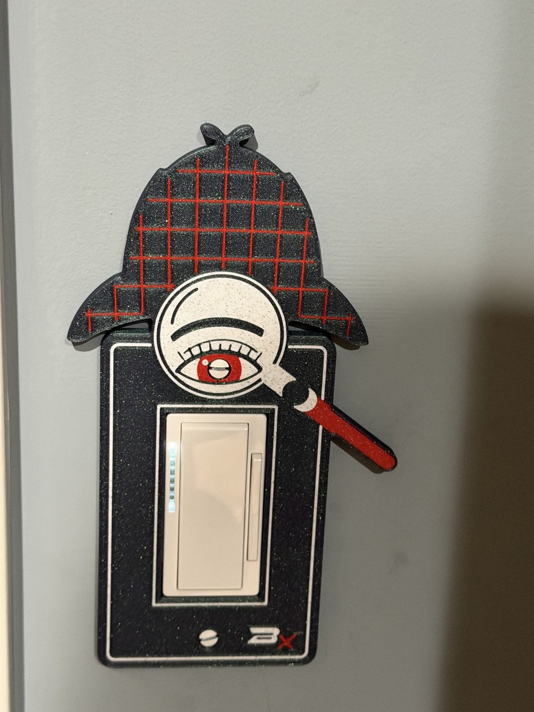

# Sherlock Switch Plate

**Also on MakerWorld:** [Sherlock Holmes Light Switch Plate (Decora Rocker)](https://makerworld.com/en/models/3459979-sherlock-holmes-light-switch-plate-decora-rocker)

Sherlock Holmes as a cover for a US rocker light switch. The plate wears his
deerstalker, and a magnifying glass is held up under its peak, with one huge
red-irised eye staring out through the lens. The top screw is the eye's
pupil.

About 109 × 186 mm and 6 mm deep. It fits one **Decora (rocker) switch** and
covers everything a standard 2.75" × 4.5" plate does, with at least 3 mm to spare.

It sticks out past a normal plate, and not evenly. **The glass's handle
reaches 61 mm to the right of the switch's centre** and the hat's brim 48 mm
to the left. The switch needs clear, flat wall that far on each side. A door
casing, a second switch or a corner any closer will hold the plate off the
wall.

## Files

| file | colour | what it is |
|---|---|---|
| `sherlock_body.stl` | any dark colour (a sparkle black works well) | the plate and hat |
| `sherlock_bone.stl` | bone / white | the lens, the eye, the border lines |
| `sherlock_red.stl` | red | the tweed lines, the iris, the handle, the mark's x |
| `sherlock_mark_silver.stl` | silver (or the bone filament) | the mark's B |
| `sherlock_gauge.stl` | anything | a quick one-colour fit test, printed on its own |

## Print the gauge first

`sherlock_gauge.stl` is just the plate around the switch: the opening, both
screw holes and the hollow back, with no artwork. It is a short print in one
colour. Screw it on and check:

- the rocker sits in the opening without rubbing, and rocks freely
- BOTH screws go in and tighten (one screw alone will hold it, and hide a
  wrong spacing), and their heads sit flush in the countersinks
- the plate's face is level with the rocker's frame, and its edge sits
  on the wall all round

If any of these is off, change the matching number at the top of
`switchplate.scad` (`open_w`/`open_h`/`open_fit`, `screw_c`, `depth`) and
rebuild. Nothing else depends on them.

## Printing

**H2D (or any multi-colour printer), PLA, 0.2 mm layers, no supports, no brim.**

1. Import the four colour STLs together and load them as **one object with
   several parts**. They're already positioned.
2. Give each part its filament from the table.
3. It prints **face down**: the artwork is on the bed, so it comes out smooth,
   and every colour change happens in the first 0.8 mm. The back, with the
   hollow for the switch, faces up.

Studio will warn about separate bodies in the inlay parts: each one holds
many separate pieces of artwork. That's expected.

## Mounting

Two #6-32 oval-head screws, the same ones the old plate used. The plate
screws go into the switch's mounting strap, 3-13/16" (96.8 mm) apart, the
standard Decora plate spacing. A black screw at the top makes the darkest
pupil.

## Remixing

- **The artwork** is drawn in `art.py` (Python, with shapely), using the
  designer's bookmarks drawing kit. It writes `art.scad`. The script asserts
  that the plate still covers a standard plate, that the lens clears the
  rocker's frame, and how far the art reaches on each side, so a remix that
  breaks one of these stops with a number.
- **The 3D plate** is `switchplate.scad`: depth, opening, screws, hollow and
  inlay depth are parameters at the top. The model asserts what it can't show:
  that the countersink stays inside the overhang limit, that the screw bosses
  clear the opening, and that the inlay is a whole number of layers.

`./build.sh` regenerates everything. It needs Python 3 and OpenSCAD, and the
first run makes a `.venv/` with shapely and matplotlib. The sources keep their
folder layout, because they find each other by relative path:
`Sherlock Switch Plate/` holds the plate, `Halloween Bookmarks/lib.py` is the
drawing kit, and `Makers Mark/` is the mark library. Keep the three folders
side by side.

**What's in the download:** the STLs and the OpenSCAD sources. The model sites
don't accept scripts, so the Python and shell tooling named above isn't included;
the `.scad` files, including the generated ones, open and render in OpenSCAD on
their own.

## Licence

CC BY-NC-SA 4.0, see `LICENSE`. The BX mark on the plate is the designer's
signature and isn't covered by it. Remixes must not reuse it.

Sherlock Holmes is a public-domain character, created by Arthur Conan Doyle.
This is an original drawing, not based on any actor, film or adaptation.
This project is not affiliated with or endorsed by the Conan Doyle Estate.
