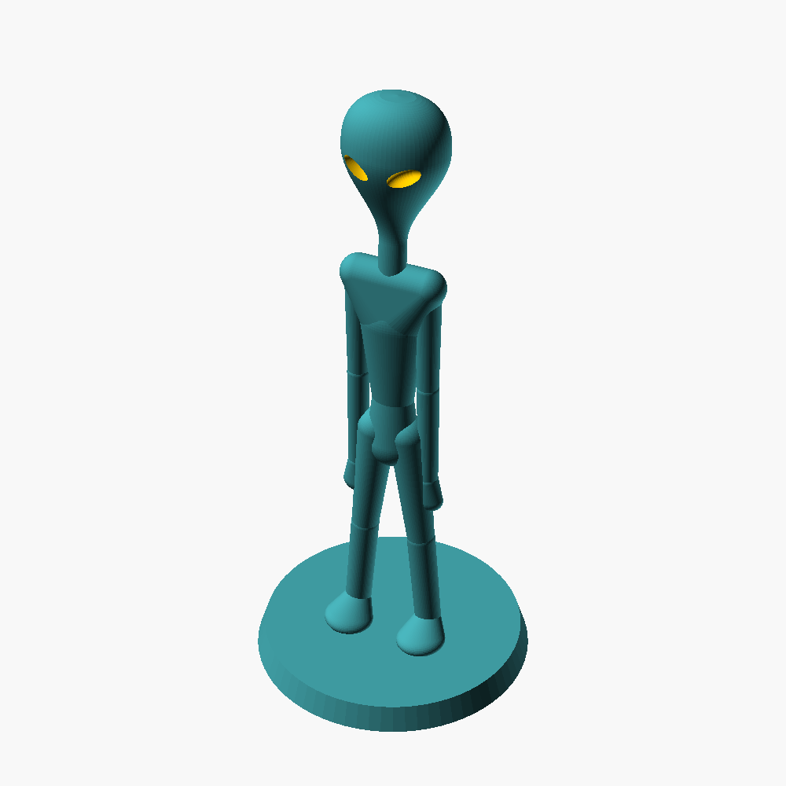

# Standing Grey Alien

A classic "grey" alien standing on a round plinth: big flared skull, almond
eyes, spindly limbs, hands resting against its thighs. Made as a photography
prop and a desk figure.

It is 93 mm tall including the plinth (90 mm of alien on a 3 mm base), and the
plinth is 42 mm across. It prints standing up, in one piece, with no supports,
and uses about 10 cm³ of filament.

Its silhouette is also the shadow in the porthole of the companion
**UFO lens saucer** (published separately).

## Files

| file | what it is |
|---|---|
| `stl/alien_figure.stl` | the figure, ready to print |
| `source/alien.scad` | the OpenSCAD source |

## Printing

- **One colour.** Grey PLA is the obvious choice. Matte filament hides layer
  lines on the skull best. Paint the eye recesses black afterwards if you want
  them to pop.
- **Orientation:** standing upright on the plinth, exactly as the STL loads.
- **Supports: none.** Every flare on the figure (the skull, the shoulders, the
  feet) is shaped to stay inside the overhang a printer can manage at 0.2 mm
  layers.
  The hands rest against the thighs so they grow from the layers below them.
- **Layer height: 0.2 mm or finer.** 0.2 mm is the coarsest the overhangs were
  designed for. 0.12 to 0.16 mm gives a smoother skull.
- 0.4 mm nozzle, PLA, 15 % infill is fine.
- **Brim:** usually not needed, because the plinth is a solid 42 mm disc. If your
  plate is not freshly cleaned, a 3 mm brim costs nothing and stops a tall
  thin print from ever being knocked loose.
- Print slowly near the top (or let your slicer's minimum layer time do it):
  the neck is the thinnest cross-section and the head above it is the heaviest
  part.

Developed on a Bambu Lab P1S.

### The tiny holes in the neck and ankles

The neck and ankles carry the whole figure and are only about 4 mm across. To
make them stronger without making them thicker, the model has a ring of four
**0.2 mm holes** running up inside each of them. They are too narrow for the
nozzle to fill, so the slicer lays solid walls around them instead of sparse
infill. You cannot see them from outside.

Some slicers flag these as "internal voids". That is expected. Check the
layer preview at the neck: you should see small extra wall loops. If your
slicer closes them up instead, set `micro_w = 0.3` (see Remixing). If you would
rather not have them at all, set `micro = false`.

### About the supplied STL

OpenSCAD builds the limbs from overlapping rounded shapes, and where they meet
it leaves a handful of hairline gaps in the mesh (a few edges out of ~37,000).
The supplied `alien_figure.stl` has had those gaps closed by merging duplicate
vertices, so it is watertight. That does not change the shape: a fresh export
from `alien.scad` has the same size and volume and prints the same. If you
export your own, most slicers repair those few edges automatically on import.

## Remixing

Open `alien.scad` in [OpenSCAD](https://openscad.org/) and change the numbers
near the top. Then render with F6 and export with File > Export > Export as
STL, keeping `part = "figure"`. (Other `part` values show single body parts for
checking; they are not prints.)

| setting | default | what it does |
|---|---|---|
| `H` | 90 | height of the figure above the plinth, mm. Everything scales from this |
| `head_tilt` | -4 | chin down (−) or up (+), degrees |
| `leg_spread` | 5 | stance width, degrees |
| `arm_spread` | 0 | arms out from the body, degrees |
| `arm_swing` | 0 | arms forward (+) or back (−), degrees |
| `flare_p` | 2.0 | how concave the skull is from chin to temple |
| `micro`, `micro_w` | true, 0.2 | the strengthening holes described above |

Things to know before you change them:

- **Size:** the figure was tuned at `H` = 85 to 90. Going bigger is always
  fine. Going smaller brings the eyes and hands close to the finest detail a
  0.4 mm nozzle can print; the file checks the gap between the eyes and stops
  with an error message if they would merge into one slot.
- **Posing the arms lifts the hands off the thighs**, and then they are
  hanging in mid-air with nothing under them. Any non-zero `arm_spread` or
  `arm_swing` needs supports under the hands. Keep `arm_spread` under about 45
  degrees, or 55 at most, and check the overhang preview in your slicer.
- Thin features are held at 1.2 mm or more after scaling (`min_feat`), so
  shrinking the figure fattens the hands rather than printing them as smudges.

## Licence

[CC BY-NC-SA 4.0](https://creativecommons.org/licenses/by-nc-sa/4.0/). See
`LICENSE`.
