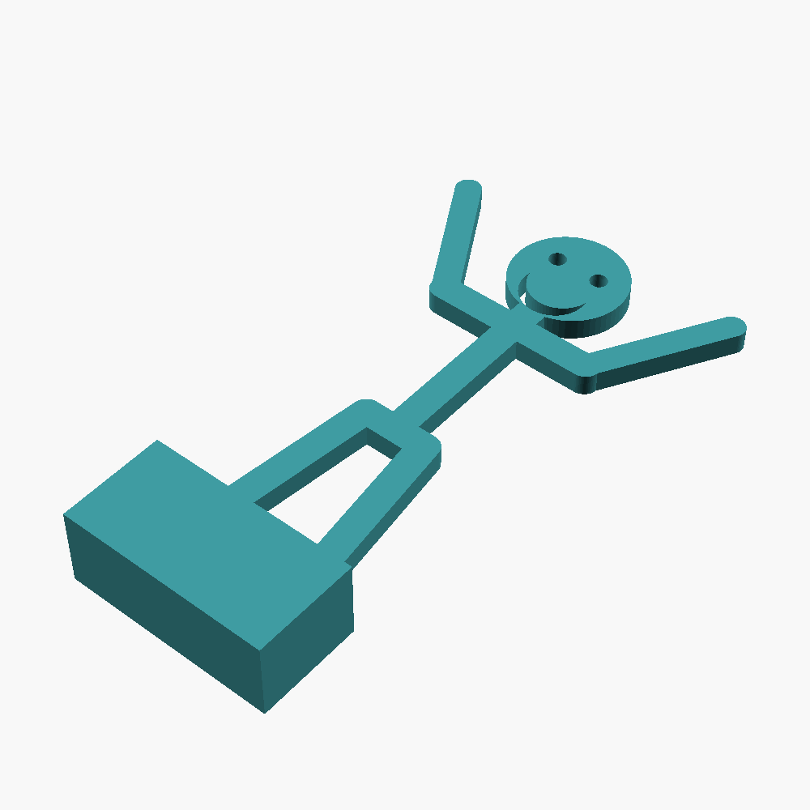

# Stick Figure Props



Flat stick-figure cutouts with expressive faces, made as photography props.
There are six moods, an Edgar Allan Poe, and a raven to stand beside him.
Each one comes in two versions:

- **tang:** a plain tab under the feet that plugs into a separate slot
  stand. Print one stand and swap figures in and out of it.
- **block:** the feet are cast into a solid plinth, so the figure stands up
  on its own without a stand.

The figures are about 150-165 mm tall and 6 mm thick. The raven is about
110 mm long.

| mood | how it reads |
|---|---|
| happy | arms up, big smile |
| sad | arms down, frown, a tear |
| shocked | arms flung out, wide eyes, open mouth |
| scared | hands up by the head, wide eyes, wavy mouth |
| stoic | arms straight out, flat mouth |
| half | one brow and one arm raised, lopsided smile |
| poe | swept hair, heavy brows, moustache, wing collar |

## Files

| file | what it is |
|---|---|
| `stl/stick_<mood>_tang.stl` | a figure with a tab, for the stand |
| `stl/stick_<mood>_block.stl` | the same figure on its own plinth |
| `stl/stick_poe_tang.stl`, `stl/stick_poe_block.stl` | Edgar Allan Poe |
| `stl/stick_raven_tang.stl`, `stl/stick_raven_block.stl` | the raven |
| `stl/stick_stand.stl` | the slot stand, 76 × 34 × 16 mm. It takes every tang figure and the raven. |
| `source/stick_figures.scad` | the OpenSCAD source for all of them |
| `images/` | renders |

Each figure is one piece in one colour. Black reads as a silhouette. White
or a bright colour shows the faces best. The faces and the raven's eye,
wing and tail feathers are cut right through the plate, so a light behind
the figure shines through them.

## Printing

- PLA, 0.4 mm nozzle, 0.2 mm layers. The originals were printed in PLA on a
  Bambu Lab P1S.
- **Print lying flat**, as the STLs are saved. No supports. On the block
  versions the figure lies flat on the bed and the plinth rises behind it.
  Nothing overhangs.
- The stand prints upright with the slot open at the top. No supports.
- 2-3 walls and 15 % infill are plenty.
- The slot is 0.5 mm wider than the 6 mm figures. In PLA on the P1S that
  gives a snug, correct fit. If your printer runs wide and the tab won't go
  in, raise `fit_clearance` (see Remixing). Don't sand the tab: it is
  supposed to be 6 mm.
- The finest details are the face cut-outs. They print cleanly with a
  standard 0.4 mm nozzle. Don't scale the figures down much, or the eyes
  and brows will close up.

## Remixing

Open `stick_figures.scad` in [OpenSCAD](https://openscad.org/). Three
settings at the top choose what you get:

| setting | values |
|---|---|
| `part` | `"figure"`, `"stand"` or `"raven"` |
| `mood` | `"happy"`, `"sad"`, `"shocked"`, `"scared"`, `"stoic"`, `"half"` or `"poe"` |
| `base` | `"tang"` for the stand, `"block"` for a plinth |

Other useful numbers:

| setting | default | what it does |
|---|---|---|
| `thickness` | 6 | plate thickness. The stand's slot follows it. |
| `limb_w` | 8 | width of the arms and legs |
| `head_r` | 16 | head radius |
| `arm_len`, `leg_len` | 40, 54 | limb lengths |
| `fit_clearance` | 0.5 | how much wider the stand's slot is than the plate |
| `block_w`, `block_h`, `block_d` | 58, 28, 22 | plinth size. `block_d` is the depth that keeps it upright. |

The arm and leg angles for each mood are in `figure()`. Angles are measured
from straight down, so 0 hangs down and 180 points straight up. To add a
mood, give it angles there and a face in `face()`.

Export from the command line:

```sh
openscad -D 'mood="sad"' -D 'base="block"' -o stick_sad_block.stl stick_figures.scad
openscad -D 'part="raven"' -o stick_raven_tang.stl stick_figures.scad
openscad -D 'part="stand"' -o stick_stand.stl stick_figures.scad
```

Or change the settings in the file, press F6 to render, then use File >
Export > Export as STL.

`render_all = true` lays out every mood side by side as a preview. Poe's
hair, collar and longer neck only appear when `mood = "poe"`, so in that
layout he shows up as a plain figure with a moustache. Export him with
`mood` set.

## Licence

[CC BY-NC-SA 4.0](https://creativecommons.org/licenses/by-nc-sa/4.0/). See
`LICENSE`.
