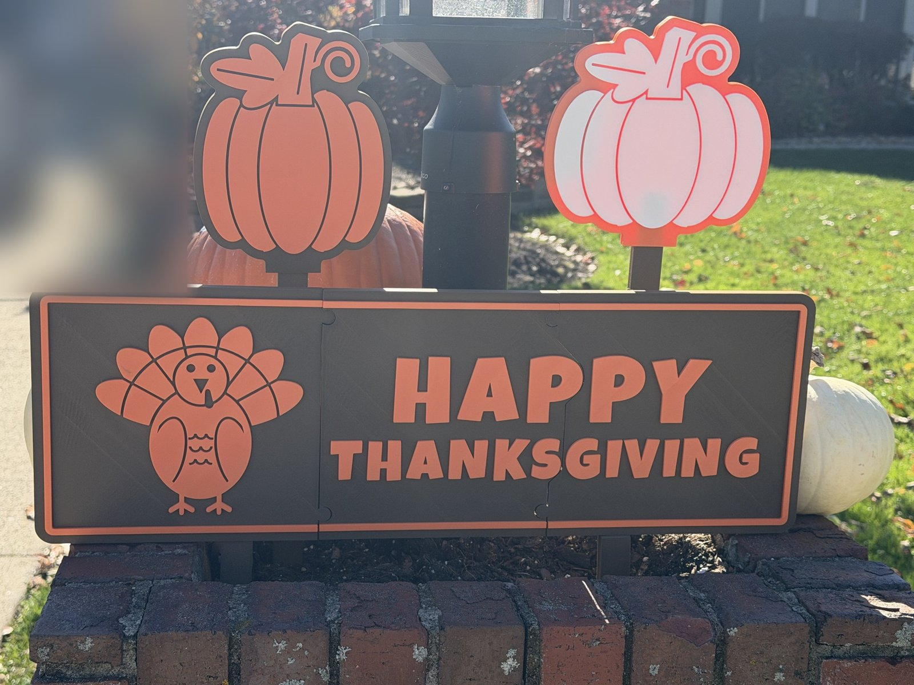

# Happy Thanksgiving

A Thanksgiving yard sign: **HAPPY THANKSGIVING** in chunky lettering beside
a fanned-tail turkey, raised orange on a brown board, on two push-in ground
stakes.

About 600 × 200 mm, 13 mm thick. It prints in three pieces that snap
together. Each piece fits a 230 mm bed, so any printer with a 256 mm bed will
do, but only with the prime tower turned off (see Printing). The joins wind
between the letters, so no letter is ever cut in two.

The photos also show the companion **Thanksgiving Pumpkins**, a separate
model: two flat pumpkins on tall stakes that stand behind the sign and show
above it.

## Files

| file | colour | what it is |
|---|---|---|
| `sign_1_board.stl`, `sign_2_board.stl`, `sign_3_board.stl` | brown | the board, in three pieces, 10 mm |
| `sign_1_art.stl`, `sign_2_art.stl`, `sign_3_art.stl` | orange | the raised art on each piece, 3 mm |
| `sign_3_mark_silver.stl`, `sign_3_mark_red.stl` | silver, red (optional) | the designer's mark, on the back of piece 3 |
| `stakes.stl` | brown (anything) | both stakes, one plate |
| `sign_1.stl`, `sign_2.stl`, `sign_3.stl` | | each piece as ONE STL, both colours together, for a filament change by layer instead |

Piece 1 is the turkey, piece 2 is HAP and THANKS, piece 3 is PY and
GIVING.

## Printing

**PLA, 0.4 mm nozzle, 0.2 mm layers, no supports, no brim, prime tower
off.** Four plates: three pieces and the stakes. Each piece is about 3 to 3.5 hours
on a P1S.

**Turn the prime tower off** (Bambu Studio: Others → Prime tower → Enable).
A piece leaves no room beside it for the tower on a 256 mm bed, and with only
one colour change per plate the tower isn't needed: a Bambu printer purges
the change into its waste chute instead.

Each piece prints flat, face up:

1. Import `sign_N_board.stl` and `sign_N_art.stl` together and load them as
   **one object with several parts**. They're already positioned; don't move
   them.
2. Board: brown. Art: orange.
3. The colours only meet at 10 mm up, so there is one filament change per
   plate and almost no purge.

**One colour at a time instead:** import `sign_N.stl` alone and add a
filament change at the first layer above **10.0 mm** in the slicer's layer
view.

**The mark:** on piece 3, also load `sign_3_mark_silver.stl` and
`sign_3_mark_red.stl` as parts and give them silver and red. They sit in the
first three layers of the back. Leave them out and the mark prints as an
engraving.

Studio may warn about separate bodies in the art parts: each letter is a
separate piece of art sitting on the board. That's expected.

## Assembly

1. Lay the three pieces face down on a flat table and dry-fit them. Each join
   has two jigsaw knobs and 0.22 mm of clearance a side.
2. Press the joins together. The jigsaw knobs hold the sign on their own,
   so glue is optional. Add some if you want it permanent.
3. Push the stakes into the ground about 300 mm apart: measure between the
   two pockets in the board's bottom edge.
4. Lower the sign onto the stakes. Each stake's flat tongue goes into a
   pocket, with the **flat side of the stake toward the front**, so the
   thicker shank sits behind the sign. The board's bottom edge rests on the
   shank's shoulders, 50 mm above the grass.

## Remixing

- **The art and the 3D parts** are `sign.scad`. The wording, font, cap
  height, board size and the turkey's proportions are parameters at
  the top. The model asserts that the skin over each stake pocket is thick
  enough and that the stakes fit a 230 mm bed.
- **The joins** come from `split.py` (Python, with shapely and numpy). It
  reads the art straight out of `sign.scad`, routes each join along the
  shortest path that stays clear of every letter, places the jigsaw knobs
  where there is room, and writes `sign_split.scad`. Change any art and run
  it again. It checks that no art is cut, that each letter lies in one piece,
  and that every piece fits the bed.

`./build.sh` regenerates everything. It needs Python 3 and OpenSCAD, and the
first run makes a `.venv/` with shapely and numpy. `sign.scad` finds the BX
mark at `../Makers Mark/mark.scad`, so keep the two folders side by side.

**What's in the download:** the STLs and the OpenSCAD sources. The model sites
don't accept scripts, so the Python and shell tooling named above isn't included;
the `.scad` files, including the generated ones, open and render in OpenSCAD on
their own.

## Licence

CC BY-NC-SA 4.0, see `LICENSE`. The BX mark is the designer's signature and
isn't covered by this licence. Remixes must not reuse it.

The lettering is **Luckiest Guy** by Astigmatic, under the Apache License 2.0
(`fonts/LICENSE.txt`). Install Luckiest Guy (free from Google Fonts) before
rendering `sign.scad` if the font file isn't beside it.
