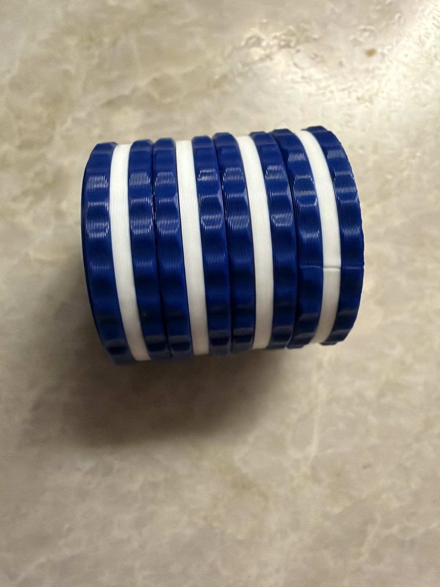

# Twisty Cookies

**Also on MakerWorld:** [Twisty Cookies: Spinning Sandwich-Cookie Fidget](https://makerworld.com/en/models/3460072-twisty-cookies-spinning-sandwich-cookie-fidget)

A palm-sized fidget: a stack of four sandwich cookies, 30mm across and about
29mm tall, that spin independently on a hidden post. Twist them, line them up,
spin them back.

It prints as **one plate, flat, in two colours, with no supports**, and snaps
together in a few seconds with no glue.

**Status (2026-10-13):** printed twice, and both came out right and fitted together first time.

## Files

| file | colour | what it is |
|---|---|---|
| `cookies_wafer.stl` | any dark colour (the photos use blue) | the eight cookie wafers, and the post on the bottom cookie |
| `cookies_cream.stl` | white | the four cream fillings |

In the release zip they're in `stl/`. From the source, `./build.sh` rebuilds
them from `cookies.scad`.

## Printing

**Any multi-colour printer (AMS, H2D), PLA, 0.16 or 0.2mm layers, no supports, no brim.**

1. Load **both STLs together, as one object with two parts**. When Bambu
   Studio asks, say yes. They're already laid out on the plate.
2. Wafer to the dark filament, cream to the white. On the H2D, put one on each
   nozzle, so a colour change is a nozzle switch rather than a purge.
3. Slice. There are only **two colour changes in the whole print**, at 2.6mm
   and 4.6mm, so the prime tower stays about 5mm tall.

The STLs show "separate body" warnings, because they hold several cookies.
That's correct.

**Filament:** a few grams of each colour. The plate is small and quick.

## Assembly

1. Hold the bottom cookie, the one with the post.
2. Drop the two plain cookies over the post. The barb at the top squeezes
   through each hole.
3. Press the patterned cookie on top until it **clicks**.

The top three cookies now spin freely. The snap is permanent: pulling it apart
means squeezing the two prongs together through the pattern. Don't.

## Print record

- 2026-10-12/13: first print, **P1S** with AMS, 0.16mm layers, blue and white
  PLA (`twisty_cookies_p1s.3mf`). It came out clean: sharp scallops, crisp
  cream bands and a readable top pattern. The snap clicked together first
  time. The same printer had failed the stand-up versions.
- 2026-10-13: second print, P1S. Printed quickly and fitted together
  perfectly, so the fit repeats from print to print.

## Why it's designed like this

It's inspired by the twisty cookie fidgets other makers have shared, which
print the whole stack standing up, in place. That's a clever trick, but a
demanding print: every cookie starts in mid-air over a one-layer gap above
the cookie below, and the colour changes at every cream band. I couldn't get
them to print on my machine, so this version takes the other route:

- **Every cookie prints flat on the bed,** so nothing starts in mid-air.
- **All the cookies change colour at the same heights,** so the plate has two
  colour changes instead of about ten, and the prime tower can't topple.
- **The wafer above the cream steps out at 45 degrees,** so it never
  overhangs the cream.
- **The snap prongs bend 1.5%,** under the ~2% PLA takes repeatedly. The
  model asserts it.
- **The post spins in 0.3mm of clearance.** That's a rotating fit, looser than
  the 0.22mm used for locating fits. The stack has 0.4mm of axial play: it
  spins without rattling. Both were checked on the assembled model: the post
  touches no cookie at rest, and the barb catches the lip when the top is
  pulled up.

## Remixing

The release zip has the full source under `source/`. Keep its two folders
side by side: `cookies.scad` uses `../Makers Mark/mark.scad`. Then run
`./build.sh` in `Twisty Cookies/` (it needs OpenSCAD).

Everything is a parameter at the top of `cookies.scad`: the number of cookies,
size, wafer and cream thickness, edge scallops, and the snap. Asserts catch a
prong that would crack, a barb too shallow to hold, colour bands that don't
fall on whole layers, and features under 1.2mm.

**What's in the download:** the STLs and the OpenSCAD sources. The model sites
don't accept scripts, so the Python and shell tooling named above isn't included;
the `.scad` files, including the generated ones, open and render in OpenSCAD on
their own.

## Licence

CC BY-NC-SA 4.0, see `LICENSE`. The BX mark engraved under the bottom cookie
is the designer's signature and isn't covered by it. Remixes must not reuse
it. "Oreo" is a trademark of
Mondelez International. This design is in no way affiliated with,
sponsored by or endorsed by Oreo or Mondelez International.
