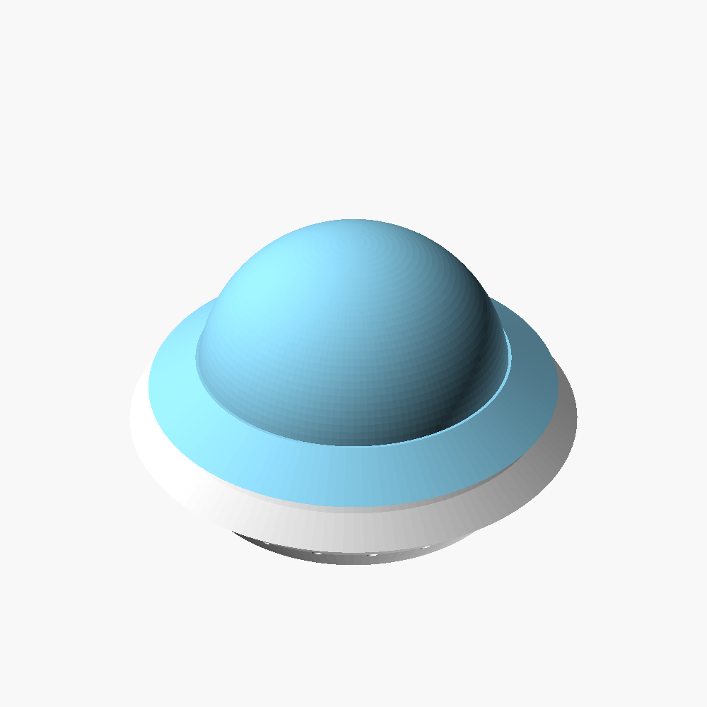

# UFO Saucers



Three 150 mm flying saucers, made as photography props. Pick one:

| saucer | look | lighting | prints |
|---|---|---|---|
| **Classic** (`ufo.scad`) | saucer body with a big lift-off dome | fairy lights inside, poking out of 24 rim holes | 2 parts |
| **Sleek** (`ufo_sleek.scad`) | one smooth seamless shell with a low central bump | lit from outside through translucent filament | 1 part |
| **Lens** (`ufo_lens.scad`) | panelled hull with stepped tiers, a glowing rim band, and an alien's silhouette in the porthole underneath | rim and porthole glow when lit | 5 parts |

The silhouette in the lens saucer's porthole is the **Standing Grey Alien**
(published separately). A printed platter that holds the lens saucer on a
store-bought turntable is also published separately as the **Saucer
Turntable Topper**.

All parts print without supports. Developed on a Bambu Lab P1S.

## Files

| file | part | size (mm) | filament |
|---|---|---|---|
| `stl/classic/ufo_body.stl` | classic saucer body | 150 × 150 × 42 | any, light colour |
| `stl/classic/ufo_dome.stl` | classic lift-off dome | 136 × 136 × 52 | translucent looks best |
| `stl/sleek/ufo_sleek.stl` | sleek one-piece shell | 150 × 150 × 43 | translucent |
| `stl/lens/ufo_lens_upper.stl` | lens saucer, top half | 126 × 126 × 22.5 | opaque (or translucent) |
| `stl/lens/ufo_lens_lower.stl` | lens saucer, bottom half | 126 × 126 × 21.5 | opaque |
| `stl/lens/ufo_lens_rim.stl` | rim collar | 138 × 138 × 8 | **clear / translucent** |
| `stl/lens/ufo_lens_porthole_lens.stl` | porthole disc with the alien cut out | 59.6 × 3 | **clear / translucent** |
| `stl/lens/ufo_lens_porthole_shade.stl` | the alien silhouette | 11 × 50 × 3 | **opaque**, black is best |

Sources are in `source/`. `alien_shadow.dxf` is the alien outline that
`ufo_lens.scad` imports; keep it in the same folder as the `.scad`.

General settings for every part: PLA, 0.4 mm nozzle, 0.2 mm layers, 15 %
infill, **no supports**. Every STL is already in its print orientation, so
load it and don't rotate it. The 150 mm parts need a bed at least
155 × 155 mm.

---

## Classic saucer with fairy lights

A saucer body with a lift-off dome. Inside, a cheap battery fairy-light
string (the thin "copper wire" kind with rice-grain LEDs) supplies the lights:
no soldering, no resistors, you just stuff it in.

- **24 holes, 3.4 mm, around the rim.** Push one LED through each from inside.
- **A central spindle (a hollow post).** Fairy-light strings have far more
  LEDs than 24, so wind the surplus round the post. It sits right under the
  dome and lights it from inside. Two notches at the top hook the free end.
- **The battery pack** lives in the cavity around the spindle.
- **A slot in the floor**, sized for a USB-C plug, with a groove out to the
  edge, so a USB lead can run out underneath without the saucer sitting on it.
- **The dome** slips over a collar on the body, friction fit.

### Printing

| part | orientation | notes |
|---|---|---|
| `ufo_body.stl` | flat bottom down | no supports, no brim needed (56 mm radius flat base) |
| `ufo_dome.stl` | rim down, dome up | no supports; the flared skirt is the first layer and grips well |

- The body's sloping underside leans out at exactly 45 degrees, which is the
  limit at 0.2 mm layers. **Don't print it with coarser layers than 0.2 mm.**
- Inside the body, the underside of the top deck is printed over open air. It
  is hidden inside the saucer, so a little droop there does not show.
- The very top of the dome's inside is a shallow overhang near the crown. It
  can look rough from inside; from outside it is fine.

### Assembly

1. Push the fairy-light LEDs through the rim holes from inside.
2. Wind the rest of the string onto the spindle and hook the end in a notch.
3. Put the battery pack in the cavity, or run a USB lead out through the slot
   in the floor.
4. Press the dome onto the collar.

---

## Sleek saucer

One piece, no seam, no holes, open underneath. Print it in translucent PLA and
light it from outside with coloured studio lights, and the whole shell glows.

### Printing

- **Orientation:** open side down, exactly as the STL loads. The bottom ring is
  the first layer.
- **Supports: none, and don't add any.** The underside is a straight 40-degree
  cone and the top is a smooth bump that only goes flat in a tiny spot right
  at the crown, small enough to bridge. Supports inside an open shell have to
  stand on the plate as tall, thin towers; they topple and make a mess.
- **Brim: yes, 5 mm, 0 mm gap.** The part stands on a 4 mm wide ring, which is
  not much contact for a 150 mm print.
- The wall is 1.8 mm thick so the light reads through it. Set 4 wall loops so
  the slicer prints it as solid wall, with no infill pattern showing through.

---

## Lens saucer (five parts)

The best-looking of the three: a lens-shaped hull with 16 panel lines, three
stepped tiers and a dome on top, a bell underneath, a glowing rim band, and a
porthole on the underside with the alien's silhouette in it.

It is **five separate prints**. Slice each one on its own.

| part | filament | orientation (as loaded) |
|---|---|---|
| `ufo_lens_upper` | opaque | flat parting face down, apex up |
| `ufo_lens_lower` | opaque | flat parting face down, bell up (already flipped for you) |
| `ufo_lens_rim` | clear | upside down, as loaded: the flat top of the rim is the first layer |
| `ufo_lens_porthole_lens` | clear | flat |
| `ufo_lens_porthole_shade` | opaque / black | flat |

The original top half was printed in silky translucent PLA and came out
clean; opaque halves make the rim and porthole stand out more.

- No supports on any part. Both halves narrow steadily as they rise, so every
  layer sits on the one below.
- The halves are left solid on purpose (only a central bore is hollow): a
  hull this shallow cannot carry a shell-shaped cavity without its inside
  overhanging. Normal 10 to 15 % infill keeps them light.
- The top half's central bore is a cone leaning 35 degrees. That is safe at
  any layer height up to 0.28 mm.
- The panel grooves are 2 mm deep, which is what reads as a shadow line in
  photos.

### Assembly

You need glue: a little CA (superglue) or plastic cement.

1. **Glue the two halves** together at their flat parting faces. Both have a
   short vertical band at the edge; line those up.
2. **Drop the rim on from above.** It slides down over the top half, centres
   itself, and stops on a cone-shaped seat that follows the hull's curve.
   Put glue on that seat face first, then drop the rim on. It covers the seam
   between the halves.
3. **Glue the alien shade into the porthole lens.** There is a 0.15 mm gap all
   round for the glue.
4. **Glue the porthole lens into the bore** in the bottom of the saucer, flush
   with the bottom face. If you are putting a small LED light inside to make
   the porthole glow, put it in the bore first.

Lit from the side, the clear rim reads as the ship's light band. Lit from
inside the bore, the porthole glows and the alien shows black against it.

---

## Remixing

Open any `.scad` file in [OpenSCAD](https://openscad.org/). Each one picks the
part to build with the `part` setting at the top. Press F6 to render, then
File > Export > Export as STL. From the command line:

```sh
openscad --render -D 'part="body"' -o ufo_body.stl ufo.scad
openscad --render -D 'part="dome"' -o ufo_dome.stl ufo.scad
openscad --render -o ufo_sleek.stl ufo_sleek.scad
openscad --render -D 'part="upper"' -o ufo_lens_upper.stl ufo_lens.scad
# and part="lower", "rim", "porthole_lens", "porthole_shade"
```

**`ufo_lens.scad` also has `view_assembly`, `view_exploded` and `view_section`.
They are pictures, not parts.** They show the five parts stacked in mid-air in
their assembled positions. Don't slice them. (`ufo.scad` has `preview` and
`section` for the same purpose.)

### Classic (`ufo.scad`)

| setting | default | what it does |
|---|---|---|
| `light_n` | 24 | number of rim holes. Keep `$fn` (144) an exact multiple of it |
| `light_d` | 3.4 | rim hole diameter, for ~3 mm LEDs |
| `dome_r`, `dome_h` | 52, 52 | dome radius and height |
| `spindle` | true | the central post for winding surplus lights |
| `usb_w`, `usb_h` | 10, 5.4 | the cable slot in the floor |
| `fit` | 0.22 | radial clearance between dome and collar. Raise it if your dome is too tight |

Keep every outward-leaning slope on the body at 45 degrees or less. The
first version leaned out at 66 degrees and fell apart two hours into the print.

### Sleek (`ufo_sleek.scad`)

| setting | default | what it does |
|---|---|---|
| `dia` | 150 | widest diameter |
| `base_r` | 66 | radius of the bottom ring. Wider makes the saucer lower |
| `under_deg` | 40 | underside cone angle from vertical. Don't exceed about 45 |
| `brim_deg` | 6 | slope of the top brim |
| `dome_r`, `dome_h` | 32, 22 | width and height of the central bump |
| `wall` | 1.8 | wall thickness. Thinner glows more |

### Lens (`ufo_lens.scad`)

| setting | default | what it does |
|---|---|---|
| `panels` | 16 | number of panel lines |
| `groove_d`, `groove_w` | 2.0, 2.2 | panel line depth and width |
| `rim_proj` | 6 | how far the rim sticks out past the hull |
| `shadow_h` | 50 | height of the alien silhouette in the porthole |
| `shadow_gap` | 0.15 | glue gap around the silhouette. Set 0 to print lens and shade together as one two-colour object |
| `clear` | 0.22 | clearance where the rim meets the hull |

`hull_r` (63) is the dimension the halves and rim mate on. If you change it,
reprint all three.

The porthole silhouette comes from `alien_shadow.dxf`. Swap in any single
closed outline as a DXF of your own to put something else in the porthole.

## Licence

[CC BY-NC-SA 4.0](https://creativecommons.org/licenses/by-nc-sa/4.0/). See
`LICENSE`.
