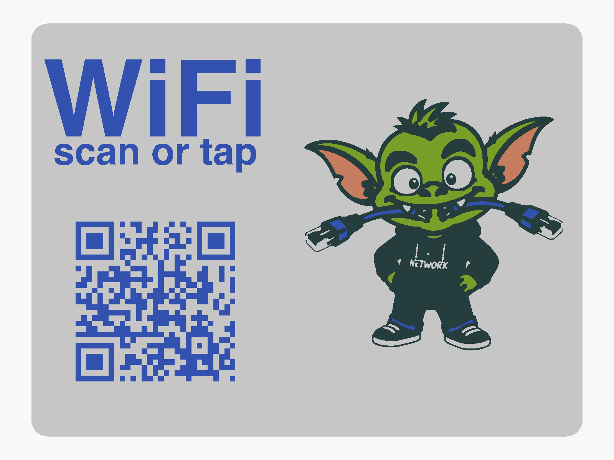

# WiFi Sign

A 200 × 150 mm desk or shelf sign for guests: a gremlin chewing on a network
cable, a QR code that joins your WiFi, and a pocket in the back for an NFC
tag, so people can scan it or tap it. It stands in a separate slotted base.

The colours are inlays printed into the first four layers, so the face is
flat and smooth, with no raised edges to catch the light or get in the way of
the QR scan.



## Make your own QR code first

**The supplied plate and ink STLs carry a placeholder code** for a network
called `YourNetwork` with the password `YourPassword`. It scans, but it won't
join anything. Make your own like this:

1. Install [OpenSCAD](https://openscad.org/) and Python 3, then
   `pip install segno`.
2. In the `source/` folder, overwrite the placeholder with your own network:

   ```sh
   python3 make_qr.py 'WIFI:S:<ssid>;T:WPA;P:<password>;;' > qr_example.scad
   ```

   Use your network name for `<ssid>` and its password for `<password>`. Use
   `T:WPA` for WPA2 or WPA3 and `T:nopass` for an open network. If the name
   or password contains `;`, `,`, `:` or `\`, put a `\` in front of it.
3. Export the two parts that carry the code:

   ```sh
   openscad --render -D 'part="plate"' -o wifi_plate.stl wifi_sign.scad
   openscad --render -D 'part="ink"'   -o wifi_ink.stl   wifi_sign.scad
   ```

   The outline, skin, ear and stand STLs don't change, so you can use the
   supplied ones.

**Your printed QR code is your WiFi password in plastic.** Anyone who can
photograph the sign can join your network and read the password from it.
Put it where you'd be happy to have the password written on the wall, and
don't post your own `qr_example.scad` or STLs online.

Scan the code with your phone before printing: open the preview in OpenSCAD
(`part="preview"`) and point the camera at the screen. The model is mirrored
so that it reads correctly once the face is printed downwards, so view it from
underneath. To check print quality first, `part="qrtest_plate"` and
`part="qrtest_ink"` make a small two-colour tile with only the code on it.

## Files

| file | colour | what it is |
|---|---|---|
| `wifi_plate_example.stl` | white | the sign, with recesses for the inlays and the NFC pocket |
| `wifi_ink_example.stl` | blue | title, QR code and cable |
| `wifi_dark.stl` | black | the gremlin's outlines, hoodie and shoes |
| `wifi_skin.stl` | green | the gremlin's skin |
| `wifi_ear.stl` | pink | the inside of his ears |
| `wifi_stand.stl` | any | the base |

Any other colours work, as long as the ink contrasts strongly with the plate.
Dark modules on a light background is what QR scanners expect.

## Loading the sign

Import the five sign STLs **together, as one object with several parts**. In
Bambu Studio or OrcaSlicer, answer "Yes" when asked whether to load them as a
single object with multiple parts. They're already in the right place
relative to each other, so don't move them. Then give each part its filament.

**It prints face down.** The front of the sign is the side on the build plate,
so it comes out as smooth as the plate. Don't flip it. The inlays fill the
first 0.8 mm, so the face is the only place the colours show.

## Print settings

- PLA, 0.2 mm layers, 0.4 mm nozzle, no supports.
- The sign needs a 200 × 150 mm bed area; the stand is 150 × 72 mm.
- **Brim width 5 mm, brim-object gap 0.** A flat plate this size is prone to
  lifting at the corners, and a brim with a gap peels off with the corner it
  should be holding down. Because the sign prints face down, the brim leaves
  a small burr around the front edge, which scrapes off.
- The stand prints as exported, in one colour.

## NFC tag (optional)

The back has a 25 mm round pocket, directly behind the gremlin's head, for an
NFC sticker such as an NTAG215. 1.4 mm of plastic is left over the tag, which
reads through without trouble. Program the tag with a phone app such as NFC
Tools, using a "WiFi network" record, then stick it in the pocket. Phones
handle WiFi tags differently (many Android phones join directly, many iPhones
don't), so the QR code is the one that works for everyone.

Use one tag, not two. Tags placed close together interfere with each other,
and the phone may end up reading neither.

## Remixing

`wifi_sign.scad` holds the layout, with the settings at the top: plate size,
QR position and module size, NFC pocket size and depth, stand depth and
lean. The gremlin artwork is in `art/` as four SVG layers, which
`gremlin.scad` places.

The title uses **Helvetica Bold**, which comes with macOS. On Linux or Windows,
set `label_font = "Liberation Sans:style=Bold";` (or any bold sans you have)
before exporting. If the named font is missing, OpenSCAD falls back to a
default font with only a warning, and the letters come out a different
shape.

Flat colour inlays print fine detail well: lines of about 0.5 mm come out
cleanly on a 0.4 mm nozzle. The exception is the QR code. Keep its modules at
least their current size, or phones may struggle to scan it.

## Licence

[CC BY-NC-SA 4.0](https://creativecommons.org/licenses/by-nc-sa/4.0/). See
`LICENSE`.
