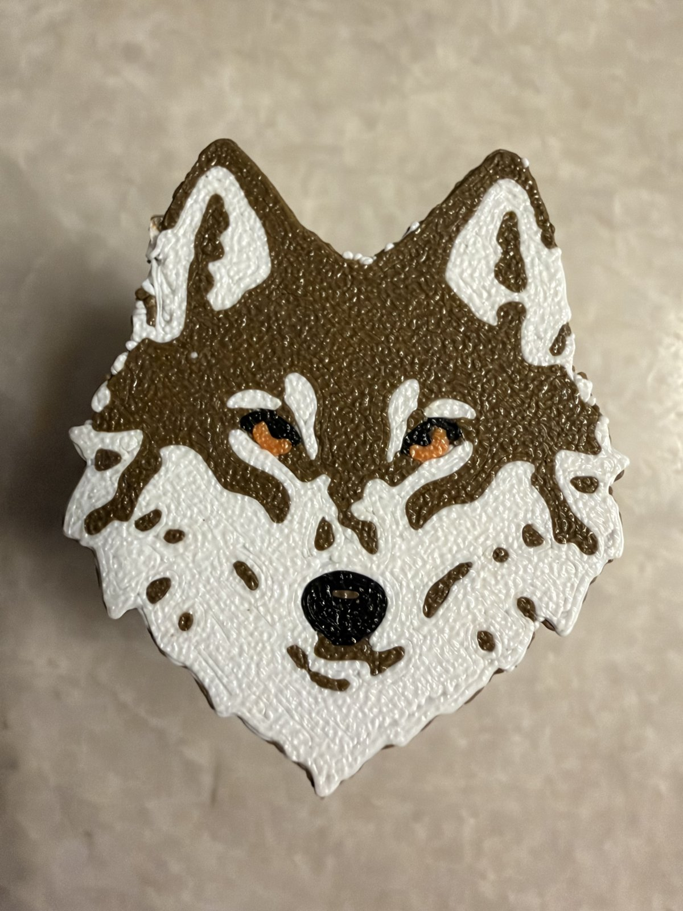

# Wolf Fidget

**Also on MakerWorld:** [Wolf Fidget: Quiet Soft-Click Twist Fidget](https://makerworld.com/en/models/3593559-wolf-fidget-quiet-soft-click-twist-fidget)

A quiet twist fidget for the classroom. A wolf's head sits on top of three
ribbed discs, and each disc turns on a hidden post with a **soft click you
feel in your fingers but can't hear across the room**. That makes it fine
during lessons and tests, where a loud clicker isn't.

It's 40 mm across and about 31 mm tall, small enough to hide in a hand. It
prints flat in PLA with no supports, and it snaps together with no glue.

The design started as a fidget for a 10-year-old who loves wolves and is
allowed only quiet fidgets in class.

## Files

| file | color | what it is |
|---|---|---|
| `wolf_cap.stl` | brown (or gray) | the head and the post on its back |
| `wolf_cream.stl` | white | the pale fur on the face |
| `wolf_black.stl` | black | eye rims and nose |
| `wolf_amber.stl` | orange | the irises |
| `wolf_discs.stl` | any (black shown) | the three click discs |
| `wolf_base.stl` | the same as the discs | the base that snaps onto the post |
| `wolf_mark_silver.stl`, `wolf_mark_red.stl` | silver, red (optional) | the designer's mark, inlaid under the base |
| `wolf_cap_plain.stl` | any | the head in one color, without the face, for a single-color printer |

## Printing

**PLA, 0.4 mm nozzle, 0.2 mm layers, no supports, no brim.** Two print jobs:

**1. The head (four colors).** Import `wolf_cap.stl`, `wolf_cream.stl`,
`wolf_black.stl` and `wolf_amber.stl` together. When the slicer asks, load
them as **one object with several parts**. They're already in position, so
don't move them. Bambu Studio names the object after the first file
alphabetically ("wolf_amber"), but it's the whole head. Check that the object
is about **40 × 46 × 23 mm**. Assign cap brown, cream white, black black and
amber orange.

The head prints **face down**: the colors are the first layers on the bed,
and the post stands straight up from the back. A smooth plate gives a glossy
face; a textured plate gives a textured one (the photos use textured).

**2. The discs and base (one color).** Import `wolf_discs.stl` and
`wolf_base.stl` as **separate objects**. The base prints upside down, so its
mark faces up. Don't flip it.

**The mark (optional):** import the base together with `wolf_mark_silver.stl`
and `wolf_mark_red.stl` as one object, and assign silver and red. Leave the
two mark files out and the mark prints as an engraving, as in the photos.

## Assembly

1. Hold the head face down. Drop the three discs over the post, either way up.
2. Press the base onto the end of the post, ribbed edge first, until it
   **clicks**. Two springy tongues inside the base catch in a groove in the
   post. It's meant to stay on: it was designed for a 10-year-old's hands.

Hold the head and turn the discs: eight soft clicks per turn. The base turns
freely too.

## Why it's quiet

A click is loud when something springs over a steep edge and slams into the
next face. Here each disc has a curved flexure tongue with a rounded nub, and
the nub rides over eight smooth, cosine-shaped flutes on the post. With no
steep face, the nub rolls into each valley instead of dropping into it. The
nub is also blunter than the valley, so it never bottoms out with a tap.

**How firm the click is** depends on your printer and plastic, so it was set
with a gauge. Set `gauge = true` in `wolf_fidget.scad` to print three discs
from light to firm, marked one, two and three dots underneath. Then set
`engage` to the one you like. This model uses the middle one, 0.65 mm.

Every spring prints **flat** and bends along the layers, never across them:
the disc tongues and the two base tongues. An earlier version had a split
snap at the tip of the post, which printed upright, and it broke twice. The
post is now a solid rod, and the model asserts each tongue's strain: under 1%
for the disc tongues, which flex thousands of times, and under 2% for the
base tongues, which flex once.

## Remixing

The release zip has the full source under `source/`. Keep its folders side
by side: `wolf_fidget.scad` uses `../Makers Mark/mark.scad`. The parameters at
the top cover the head's width, disc count and size, the click (`engage`,
the flutes and the tongues) and the base latch. Asserts catch a tongue that
would fatigue, a post too thin at its groove, colors that don't land on
whole layers, and features under 1.2 mm.

- `therian = true` engraves Θ-Δ, the therian symbol, beside the mark under
  the base. Set it to `false` to leave it off.
- The face is `wolf_art.scad`, traced from `art/wolf_reference.png` into four
  flat colors. To use your own drawing, replace the image and adjust the
  thresholds in `art/trace_wolf.py` (Python with numpy and Pillow, plus
  potrace).

**What's in the download:** the STLs and the OpenSCAD sources. The model sites
don't accept scripts, so the Python and shell tooling named above isn't
included; the `.scad` files, including the generated `wolf_art.scad`, open and
render in OpenSCAD on their own.

## License

CC BY-NC-SA 4.0, see `LICENSE`. The BX mark is the designer's signature and
isn't covered by this license. Remixes must not reuse it.

The wolf reference drawing was generated with ChatGPT from the designer's own
description, then traced and simplified into the four-color face.
